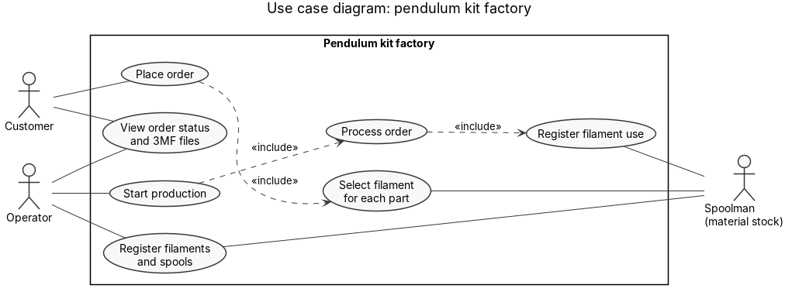
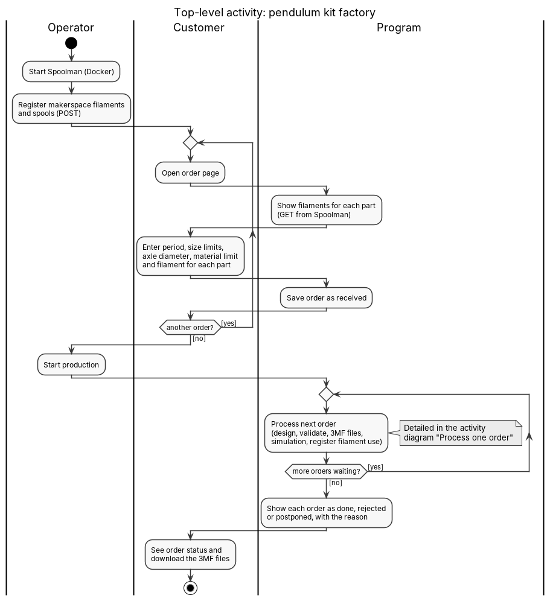
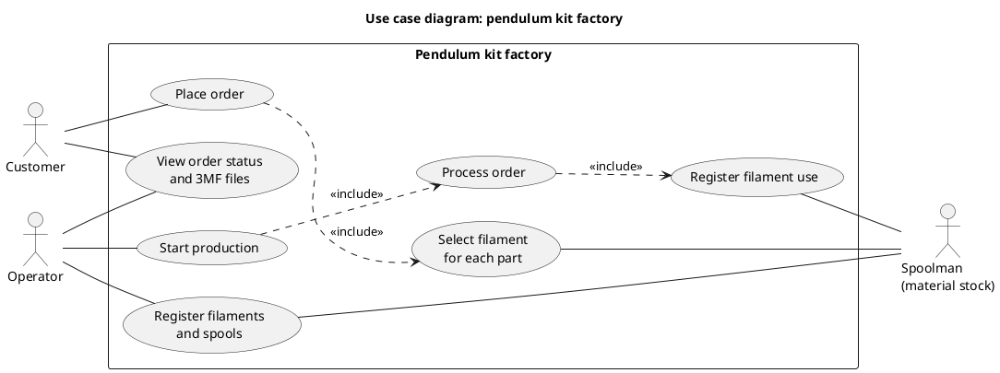
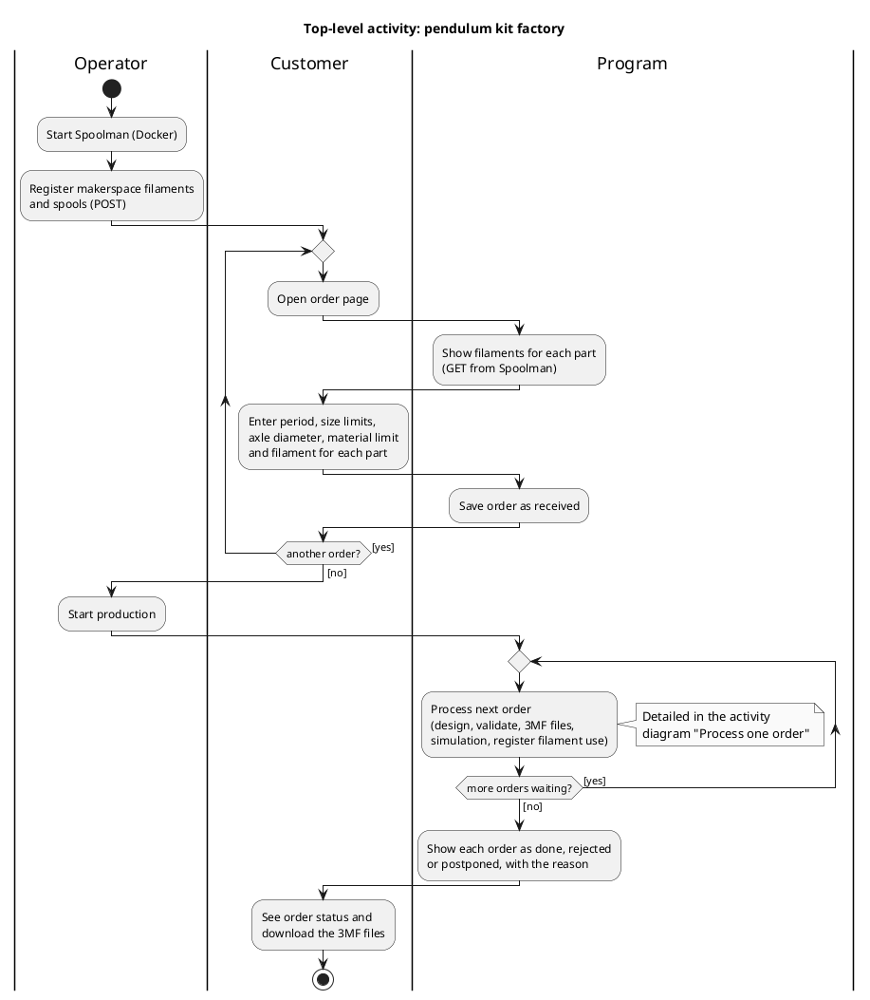

# Project plan email (draft)

> [!NOTE]
> **Shared copy.** Thomas keeps the original of this note in his Obsidian vault; this copy was synced on 2026-11-03 and converted for GitHub. Paths like `Project/...` and `repo-drafts/...` refer to the vault: the drafts are now the repos themselves. PlantUML blocks don't render on GitHub; the same diagrams are in `docs/uml/*.puml`.

The spec (§2) requires a short email to the lecturer:
- a summary of the planned solution;
- the **Canvas group number**;
- a **UML use case diagram** and a **top-level activity diagram**, both following the UML standard.

The plan must be approved **before Fri 6 Nov 16:00**. We send it **Wed 4 Nov** so there is time to revise.

## Before sending

- [ ] Group number from Canvas filled in (twice: subject and body)
- [ ] Both names filled in; send from the UiA student email, with Øivind in CC
- [ ] Lecturer's email address checked on Canvas
- [ ] Printers confirmed at the makerspace (P2S or A1); adjust the sentence if needed
- [ ] Both diagrams attached as PNG (files below), checked against [What to Know, 1. UML](what-to-know.md#1-uml)
- [ ] Both of you have read the email
- [ ] Sent 📅 2026-11-04

**Attachments** (in `Project/assets/`, rendered from the PlantUML sources in `repo-drafts/pendulum-factory/docs/uml/`):
1. `mas417-email-use-case.png`
2. `mas417-email-toplevel-activity.png`

---

## English version

**To:** <lecturer's email from Canvas>
**CC:** <Øivind's student email>
**Subject:** MAS417 project plan – group <NN>

Hi,

Here is the project plan for group <NN> (Thomas and Øivind) for the MAS417 flexible-production project. The use case diagram and the top-level activity diagram are attached.

**Planned solution**

- **Program.** A Python 3.12 program with a Flask web interface:
  - customers order a pendulum kit (swing period, size limits, axle diameter, material limit) and choose a filament for each part;
  - an operator page registers the stock and starts production.
- **Processing.** Each order is processed automatically:
  - a design solver finds the weight position that gives the ordered period, using bisection on the exact physical-pendulum period;
  - the result is checked against the size limits and the printer's build volume (Bambu Lab P2S, 256 × 256 × 256 mm);
  - orders that can't be produced are rejected or postponed, with the reason.
- **One parameter file.** All parameters for an order are kept in one JSON file. It is validated, and the CAD model, the calculations and the simulation all use it.
- **Parts.** The parts (base, two stand sides, arm with hub, weight, axle) are generated in CadQuery and exported as one 3MF file per part.
- **Mass.** Mass is estimated from the filament density, wall count and infill. We will compare it with the slicer's estimate.
- **Simulation.** The swing is simulated in a small C++20 program (RK4, built with CMake) called from Python, and compared with the calculated period. We will compare at least two design variants.
- **Stock.** Spoolman runs in Docker (version pinned):
  - we register the makerspace filaments with POST;
  - the order page shows them with GET;
  - used filament is registered with PUT;
  - the program handles Spoolman not answering and insufficient material.
- **Libraries:** CadQuery, NumPy, SciPy, Flask, Requests, Matplotlib.
- **Repositories.** Git on GitHub: a main repository with the Python and C++ repositories as submodules. You will be invited to all three.
- **Work split:**
  - Thomas: parameters, CAD, mass and period calculation, C++ simulator;
  - Øivind: Spoolman integration, web interface, order processing, variant comparison and packaging;
  - UML and the report are shared.

**Assumptions we would like you to confirm**
1. The ordered swing period is for a given amplitude (default 5°), since the period depends on amplitude.
2. "Amount of material" means the maximum filament mass per kit in grams.

Best regards,
Thomas and Øivind
Group <NN>

---

## Norsk versjon

**Til:** <foreleserens e-post fra Canvas>
**Kopi:** <Øivinds student-e-post>
**Emne:** MAS417 prosjektplan – gruppe <NN>

Hei,

Her er prosjektplanen for gruppe <NN> (Thomas og Øivind) i MAS417-prosjektet om fleksibel produksjon. Use case-diagrammet og aktivitetsdiagrammet på toppnivå ligger vedlagt.

**Planlagt løsning**

- **Program.** Et Python 3.12-program med webgrensesnitt i Flask:
  - kunder bestiller et pendelsett (svingeperiode, maks størrelse, akseldiameter, materialgrense) og velger filament for hver del;
  - en operatørside registrerer lageret og starter produksjonen.
- **Behandling.** Hver ordre behandles automatisk:
  - en designløser finner vektposisjonen som gir ønsket periode, med halveringsmetoden på den eksakte perioden for en fysisk pendel;
  - resultatet sjekkes mot størrelsesgrensene og skriverens byggevolum (Bambu Lab P2S, 256 × 256 × 256 mm);
  - ordrer som ikke kan produseres blir avvist eller utsatt, med begrunnelse.
- **Én parameterfil.** Alle parametere for en ordre ligger i én JSON-fil. Den valideres, og CAD-modellen, beregningene og simuleringen bruker den alle.
- **Deler.** Delene (bunnplate, to sidestøtter, arm med nav, lodd, aksel) genereres i CadQuery og eksporteres som én 3MF-fil per del.
- **Masse.** Massen estimeres fra filamentets tetthet, antall vegger og infill. Vi vil sammenligne den med slicerens estimat.
- **Simulering.** Svingningen simuleres i et lite C++20-program (RK4, bygget med CMake) som kalles fra Python, og sammenlignes med beregnet periode. Vi sammenligner minst to designvarianter.
- **Lager.** Spoolman kjører i Docker (fast versjon):
  - vi registrerer makerspace-filamentene med POST;
  - bestillingssiden viser dem med GET;
  - brukt filament registreres med PUT;
  - programmet håndterer at Spoolman ikke svarer og at det er for lite materiale.
- **Biblioteker:** CadQuery, NumPy, SciPy, Flask, Requests, Matplotlib.
- **Repoer.** Git på GitHub: et hovedrepo med Python- og C++-repoene som submoduler. Du blir invitert til alle tre.
- **Arbeidsfordeling:**
  - Thomas: parametere, CAD, masse- og periodeberegning, C++-simulator;
  - Øivind: Spoolman-integrasjon, webgrensesnitt, ordrebehandling, variantsammenligning og pakking;
  - UML og rapporten deles.

**Antakelser vi gjerne vil ha bekreftet**
1. Ønsket svingeperiode gjelder for en gitt amplitude (standard 5°), siden perioden avhenger av amplituden.
2. «Mengde materiale» betyr maksimal filamentmasse per sett i gram.

Med vennlig hilsen
Thomas og Øivind
Gruppe <NN>

---

## Attachment 1: Use case diagram

## Attachment 2: Top-level activity diagram

The detailed activity diagram for processing *one* order (plan §4) is **not** attached. The spec asks for the top-level flow in the plan email; the detailed one goes in the report (§3.3).

---

## Diagram sources (PlantUML)

Edit here or in `repo-drafts/pendulum-factory/docs/uml/`. Then re-export: right-click the rendered diagram in Obsidian and save the image.

