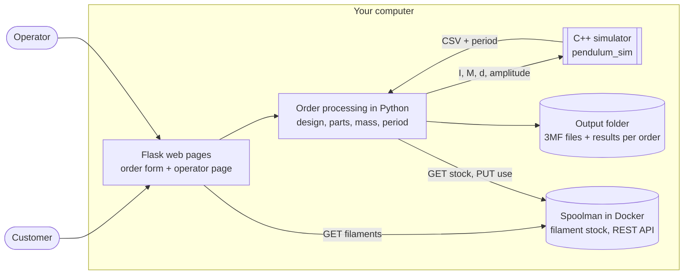
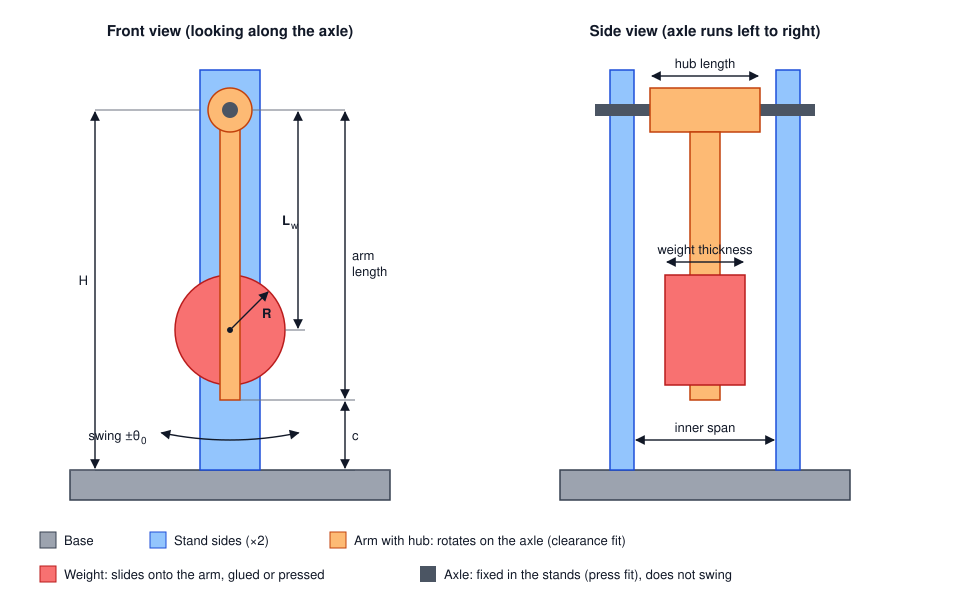
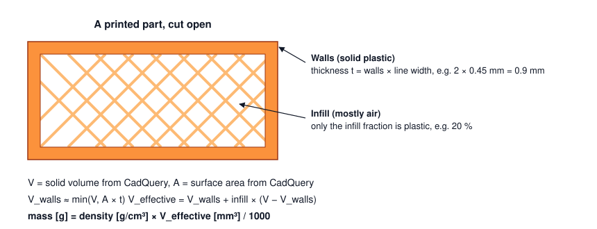
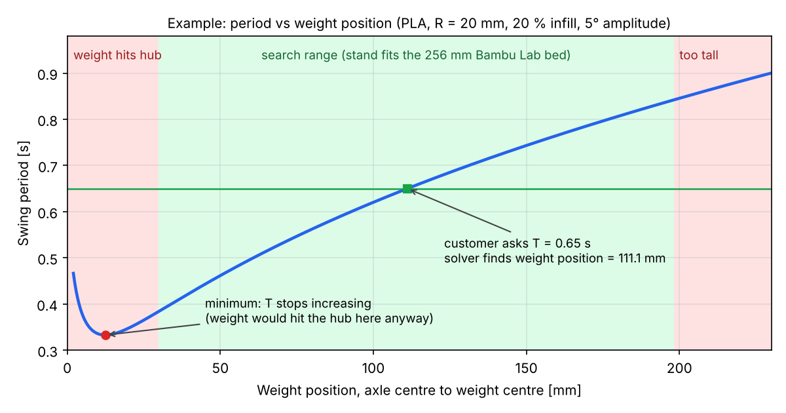
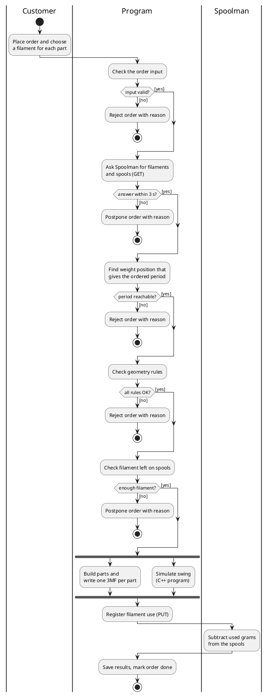
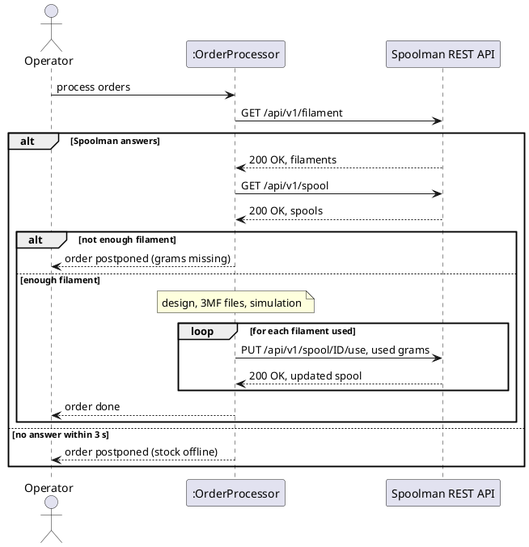
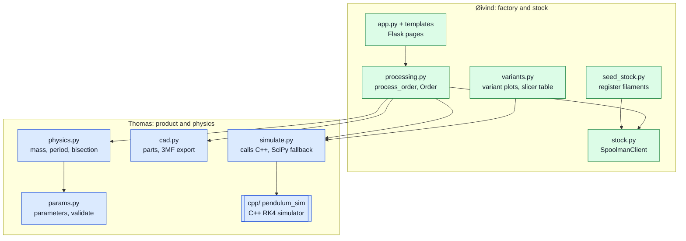
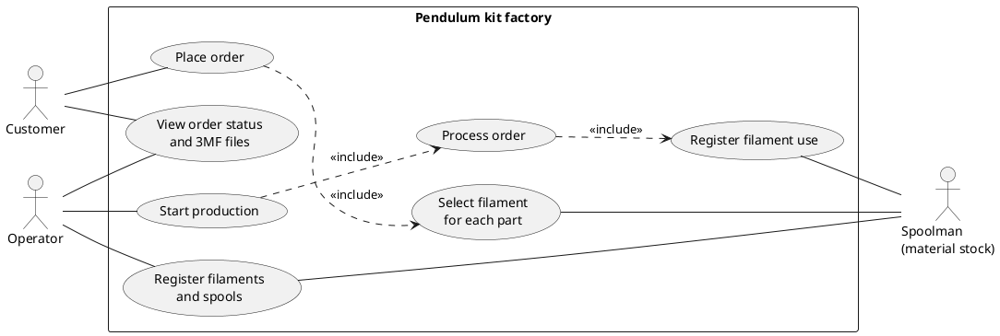
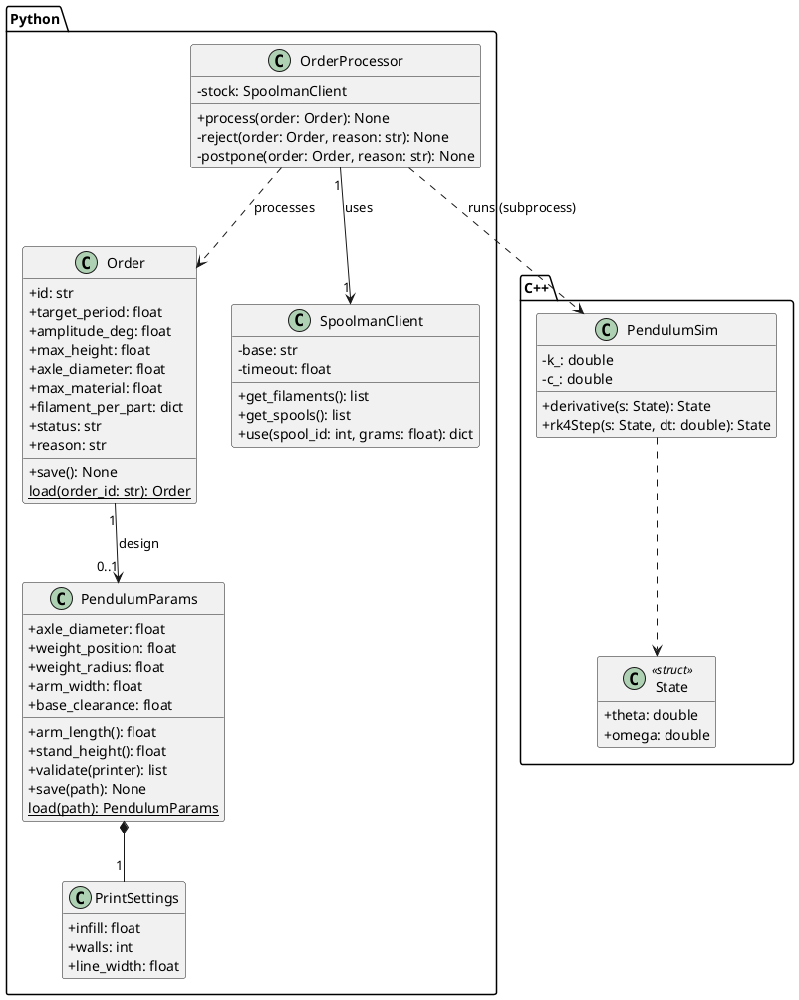
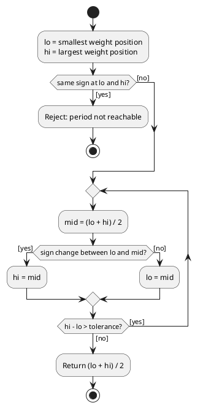

# MAS417 Project: Pendulum Kit Factory

> [!NOTE]
> **Shared copy.** Thomas keeps the original of this note in his Obsidian vault; this copy was synced on 2026-11-03 and converted for GitHub; §4 (geometry rules), §8, §11 (`validate` signature) and the printer name were updated on 2026-11-11. Paths like `Project/...` and `repo-drafts/...` refer to the vault: the drafts are now the repos themselves. PlantUML blocks don't render on GitHub; the same diagrams are in `docs/uml/*.puml`.

> [!IMPORTANT]
> **Key dates**
> - **Plan approved:** Fri 6 Nov, 16:00. We send it **Wed 4 Nov**.
> - **Hand-in:** 19/20 Nov. Confirm the exact time in WISEflow. We aim to hand in **Wed 18 Nov**.
> - **Team:** Thomas (product and physics) and Øivind (factory and stock), about 3 weeks, alongside other courses.

> [!NOTE]
> **Needs one Obsidian plugin**
> The UML diagrams (§4, §5.3, §11) are written in **PlantUML**, the standard UML text format. Install the community plugin **"PlantUML"** to render them. It sends the diagram text to plantuml.com to draw it.
> The other diagrams are Mermaid, which Obsidian renders natively. The rest are images in `Project/assets/`.
> **New to UML?** Start with [What to Know, 1. UML](what-to-know.md#1-uml).

---

## 1. Scope: build small, finish properly

**The rule:** build the smallest program that meets every *must* in §3.1, keep it clean and working, and write a good report. The report is the main deliverable (§8).

### What we must build (§3.1) and the simplest way to do it

| Requirement | Simplest way that fully meets it |
|---|---|
| Customer orders in a GUI and picks a filament for each part | Flask with **two pages**: an order form and an orders/operator page |
| Orders are processed automatically. The period matches the order, the difference is reported, and impossible orders are rejected or postponed with a reason | One function `process_order(order)` that runs the steps in §4. The operator clicks "Process orders" |
| 3MF files for every produced order | **One 3MF per part**, so no plate-layout code is needed |
| Parts generated from parameters | CadQuery boxes and cylinders with holes |
| One shared parameter file, validated | A `PendulumParams` dataclass saved as `design.json`, with `validate()` |
| Spoolman POST/GET/PUT, plus handling of "not answering" and "not enough material" | A small `SpoolmanClient` class, a seed script, and `try/except` around every call |
| Mass from density, infill and walls. Swing period | About 20 lines of NumPy/SciPy (§3.1–3.2) |
| Simulate the motion and compare 2 variants | **C++ simulator** (§3.4) + two Matplotlib plots |
| At least 2 external libraries besides REST | CadQuery, NumPy, SciPy, Flask, Requests, Matplotlib |
| 4 UML diagrams and a "Use of AI" section | PlantUML drafts in this note |
| Git throughout, organised as recommended (§7) | Main repo + Python repo + C++ repo as **submodules**. See [Repo Setup](repo-setup.md) |

### Two languages: what goes where

- **C++:** one small, separate program, the **pendulum simulator** (about 80 lines). It takes I, M, d and the amplitude as command-line arguments, integrates the motion with RK4, writes a CSV file and prints the measured period.
- **Python:** everything else. It calls the C++ program with `subprocess`.

**Why the simulator:**
- It's the only part that is pure number-crunching. It needs no libraries, and the interface (numbers in, numbers out) is tiny.
- If the C++ program isn't built on the examiner's machine, Python falls back to SciPy, so the project still runs.
- The C++ result checked against the exact formula and against SciPy is a nice verification table for the report.

### What we skip, and why

| Skipped                                                                                    | Why it's safe to skip                                                                                         |
| ------------------------------------------------------------------------------------------ | ------------------------------------------------------------------------------------------------------------- |
| MuJoCo                                                                                     | Recommended, not required. Our own C++ RK4 simulator fulfils "simulate the motion" and shows the language mix |
| Multiprocessing, packing parts onto print plates, CI pipeline, Docker image of our program | Recommendations or optional extras                                                                            |

### If time (in this order, only after the 11 Nov milestone)

1. Try 2–3 weight radii and pick the lightest design that works.
2. Process orders in parallel with `ProcessPoolExecutor` (about 10 lines).
3. Print one kit on the P1S, weigh it, and time the swings. This counts as a plus (§8).

**Budget:** about **25 h of code per person**, plus about 12 h of report and about 9 h of shared work. That is roughly **46 h each**.

---

## 2. How the system works



---

## 3. The pendulum



| Symbol | Meaning | Set by |
|---|---|---|
| L_w | weight position: axle centre to weight centre | **solved** so the period matches the order |
| R | weight radius | default 20 mm |
| arm length | L_w + R + tip | derived |
| c | clearance from the lowest swinging point to the base | default 8 mm |
| H | stand height, base top to axle | arm length + c |
| θ0 | swing amplitude the period is given for | order field, default 5° |

**Decisions to explain in the report:**
- **The axle is pressed into the stands and the arm turns on it.** Only the arm and weight swing.
- **One 3MF per part.** Each part can have its own filament. The P1S can do multi-colour jobs with an AMS, but one file per part is simpler and works on both the P1S and the A1.
- **Units:** mm and g in the JSON and CAD. Convert to m and kg *only* inside the physics.
- **Printer:** Bambu Lab P1S (fallback A1). Both have a **256 × 256 × 256 mm** build volume, so `printer.json` is the same for either. Print the stands lying flat, which makes the stand the tallest part at about 246 mm with a margin.

### 3.1 Mass of a printed part (Thomas)



```python
def part_mass(solid, density, infill, walls, line_width=0.42):
    """solid: cq.Workplane, density in g/cm³, infill 0..1. Returns grams.
    line_width 0.42 mm = Bambu Studio default for a 0.4 mm nozzle (check your profile)."""
    V = solid.val().Volume()                  # mm³
    A = solid.val().Area()                    # mm²
    V_walls = min(V, A * walls * line_width)
    V_eff = V_walls + infill * (V - V_walls)
    return density * V_eff / 1000.0
```

> [!WARNING]
> **Limitation**
> The wall volume is approximate: corners are double-counted, and the top and bottom layers are treated as walls. Verify it by slicing each part in **Bambu Studio** with the same walls and infill and comparing its filament estimate in grams. The spec mentions PrusaSlicer, but Bambu Studio does the same job for our printers.

### 3.2 Swing period (Thomas)

The moving body is a rod (the arm), plus the hub on the axle, plus a disc (the weight):

- M = m_rod + m_hub + m_weight
- d = (m_rod · L/2 + m_weight · L_w) / M
- I = m_rod · L²/3 + ½ · m_weight · R² + m_weight · L_w², where the hub term is about 0 because it sits on the axle
- **T = 4 · √(I / (M·g·d)) · K(sin(θ0/2))**, the exact period, where K is the complete elliptic integral. When θ0 is small it equals 2π·√(I/(M·g·d)).

```python
import numpy as np
from scipy.special import ellipk

def period(p, m_rod, m_hub, m_weight, g=9.81):
    """p: PendulumParams (mm), masses in g. Returns seconds."""
    L, Lw, R = p.arm_length / 1000, p.weight_position / 1000, p.weight_radius / 1000
    mr, mh, mw = m_rod / 1000, m_hub / 1000, m_weight / 1000
    M = mr + mh + mw
    d = (mr * L / 2 + mw * Lw) / M
    I = mr * L**2 / 3 + 0.5 * mw * R**2 + mw * Lw**2
    k = np.sin(np.radians(p.theta0_deg) / 2)
    return 4 * np.sqrt(I / (M * g * d)) * ellipk(k**2)   # SciPy's ellipk takes k², not k
```

Build the rod and the hub as separate solids in CadQuery, take the mass of each, and union them only for export. Tests:
- A point mass gives 2π√(L/g) when θ0 is small.
- At θ0 = 1e-6 the result equals the small-angle formula.

### 3.3 Finding the weight position (Thomas)



- The period rises as the weight moves down, so **bisection** finds the position that gives the ordered period.
- On the 256 mm bed, with PLA and R = 20 mm, the possible periods are about **0.38–0.84 s**.
- An order outside that range is **rejected**, and the reason states the range.

```python
def bisect(f, lo, hi, tol=0.01, max_iter=60):
    """Find x in [lo, hi] where f(x) = 0. tol in mm."""
    f_lo = f(lo)
    if f_lo * f(hi) > 0:
        raise ValueError("target not inside search range")
    for _ in range(max_iter):
        mid = 0.5 * (lo + hi)
        f_mid = f(mid)
        if f_lo * f_mid <= 0:
            hi = mid
        else:
            lo, f_lo = mid, f_mid
        if hi - lo < tol:
            break
    return 0.5 * (lo + hi)
```

`f(Lw)` rebuilds the arm and weight, computes the masses and returns `period(...) - target`. That is about 15 iterations, a couple of seconds per order. The algorithm diagram for the report is in §11.

### 3.4 Simulator in C++ (Thomas)

> [!NOTE]
> **AI-generated starting point**
> The files below were written and tested by Claude. The C++ period matches the exact formula to about 1e-13 at both 5° and 45°, and it compiles with no warnings at `-Wall -Wextra -pedantic`. Mark it as AI-assisted in the code and the report (§14), and make sure you can explain every line.

`cpp/CMakeLists.txt`
```cmake
cmake_minimum_required(VERSION 3.16)
project(pendulum_sim LANGUAGES CXX)
set(CMAKE_CXX_STANDARD 20)
set(CMAKE_CXX_STANDARD_REQUIRED ON)
add_executable(pendulum_sim src/main.cpp)
```

`cpp/src/main.cpp`
```cpp
// pendulum_sim: simulates a rigid pendulum, theta'' = -(M g d / I) sin(theta) - c theta'
// Usage: pendulum_sim I M d g theta0 damping t_end dt out.csv   (all SI units, theta0 in rad)
// Writes t,theta,omega to out.csv and prints "period=<seconds>" to stdout.
#include <cmath>
#include <fstream>
#include <iostream>
#include <string>
#include <vector>

struct State {
    double theta;  // angle [rad]
    double omega;  // angular velocity [rad/s]
};

class PendulumSim {
public:
    PendulumSim(double I, double M, double d, double g, double damping)
        : k_(M * g * d / I), c_(damping) {}

    State derivative(const State& s) const {
        return {s.omega, -k_ * std::sin(s.theta) - c_ * s.omega};
    }

    State rk4Step(const State& s, double dt) const {
        const State k1 = derivative(s);
        const State k2 = derivative({s.theta + 0.5 * dt * k1.theta, s.omega + 0.5 * dt * k1.omega});
        const State k3 = derivative({s.theta + 0.5 * dt * k2.theta, s.omega + 0.5 * dt * k2.omega});
        const State k4 = derivative({s.theta + dt * k3.theta, s.omega + dt * k3.omega});
        return {s.theta + dt / 6.0 * (k1.theta + 2 * k2.theta + 2 * k3.theta + k4.theta),
                s.omega + dt / 6.0 * (k1.omega + 2 * k2.omega + 2 * k3.omega + k4.omega)};
    }

private:
    double k_;  // M g d / I [1/s^2]
    double c_;  // damping [1/s]
};

int main(int argc, char* argv[]) {
    if (argc != 10) {
        std::cerr << "usage: pendulum_sim I M d g theta0 damping t_end dt out.csv\n";
        return 1;
    }
    const double I = std::stod(argv[1]), M = std::stod(argv[2]), d = std::stod(argv[3]);
    const double g = std::stod(argv[4]), theta0 = std::stod(argv[5]), damping = std::stod(argv[6]);
    const double t_end = std::stod(argv[7]), dt = std::stod(argv[8]);
    if (I <= 0 || M <= 0 || d <= 0 || dt <= 0 || t_end <= dt) {
        std::cerr << "error: I, M, d, dt must be positive and t_end > dt\n";
        return 1;
    }
    std::ofstream csv(argv[9]);
    if (!csv) {
        std::cerr << "error: cannot write " << argv[9] << "\n";
        return 1;
    }

    const PendulumSim sim(I, M, d, g, damping);
    State s{theta0, 0.0};
    std::vector<double> crossings;  // times of upward zero crossings
    csv.precision(10);
    csv << "t,theta,omega\n";
    const long steps = std::lround(t_end / dt);
    for (long i = 0; i <= steps; ++i) {
        const double t = i * dt;
        csv << t << ',' << s.theta << ',' << s.omega << '\n';
        const State next = sim.rk4Step(s, dt);
        if (s.theta < 0.0 && next.theta >= 0.0) {
            crossings.push_back(t - s.theta * dt / (next.theta - s.theta));  // linear interpolation
        }
        s = next;
    }
    if (crossings.size() < 2) {
        std::cerr << "error: fewer than two swings, increase t_end\n";
        return 2;
    }
    const double period = (crossings.back() - crossings.front()) / (crossings.size() - 1);
    std::cout.precision(12);
    std::cout << "period=" << period << "\n";
    return 0;
}
```

Build it from the main repo folder (the same commands work on Windows, macOS and Linux):

```bash
cmake -S cpp -B cpp/build -DCMAKE_BUILD_TYPE=Release
cmake --build cpp/build --config Release
```

`pendulum/simulate.py`: the Python side, with a SciPy fallback so the project runs even without a C++ compiler.
- **Full tested version:** `repo-drafts/pendulum-factory-python/pendulum/simulate.py`, with tests in `tests/test_simulate.py`.
- **Finding the simulator:** it looks in `../cpp/build/` (the C++ submodule next to the Python one in the main repo), or uses the path in the environment variable `PENDULUM_SIM`.
- **Fallback:** if the simulator isn't built, it falls back to SciPy and logs a warning.

```python
PY_ROOT = Path(__file__).resolve().parent.parent      # this repo (python/ in the main repo)
CPP_BUILD = PY_ROOT.parent / "cpp" / "build"           # ../cpp/build in the main repo

def find_simulator():
    env = os.environ.get("PENDULUM_SIM")
    if env:
        return Path(env) if Path(env).exists() else None
    for name in ("pendulum_sim", "pendulum_sim.exe", "Release/pendulum_sim.exe"):  # Release/ = Visual Studio
        if (CPP_BUILD / name).exists():
            return CPP_BUILD / name
    return None
```


> [!NOTE]
> **Be honest in the report**
> The simulator solves the same equation the formula comes from, so their agreement checks the *code*, not the *physics*. Real checks are the Bambu Studio mass comparison and, if time allows, a printed kit.

**Variants to compare** (Øivind, using `simulate.py`):
1. The same ordered period with a PLA weight and a PETG weight, or with 20 % and 100 % infill. This gives different arm lengths and masses. Plot θ(t) for both and add a table.
2. The same design swung at 5° and at 45°. This shows the period growing with amplitude.

---

## 4. One order, start to finish (UML activity diagram)

This is the required **activity diagram for one order** (§3.3), in standard UML via PlantUML.



**Postponed orders** are tried again the next time the operator clicks "Process orders".

**Geometry rules** in `validate(printer)` (§3.1). It runs after `design()` has found `WeightPos`, and returns a list of problem messages, one per broken rule (empty list = OK). Names are the fields in `python/pendulum/params.py`. Usable printer size: 5 mm free from every edge of the 256 mm bed, so 246 mm. Rules decided 10–11 Nov 2026.

Required by the spec (§3.1):
- **S1** Positive dimensions: every length field > 0, and `ArmLength` > 0. (`PendClearance` is covered by S3.)
- **S2** Weight within the arm: `WeightPos − BlockLength/2 ≥ ClrDia/2` (the block clears the collars) and `WeightPos + BlockLength/2 ≤ ArmLength` (the block ends at the arm tip at the latest). `WeightPos` runs from the axle centre to the block's centre.
- **S3** Clearance to the base: `PendClearance ≥ 5`. The gap under the arm tip always equals `PendClearance`, because `ArmLength` is calculated from it.
- **S4a** The U fits the printer standing on its base: `BaseWidth`, `BaseDepth` and `BaseHeight` ≤ 246 mm (the usable size is the same in every direction, decided 11 Nov 2026). Read from `printer.json`: build volume minus 2 × margin.
- **S4b** The pendulum fits the bed lying down: `AxleLength` ≤ 246 mm and `ArmLength + ClrDia/2` ≤ 246 mm.

Our own (from the U-stand design):
- **O1** Posts fit on the base: `PostDepth ≤ BaseDepth`.
- **O2** The block fits on the arm: `0 < BlockLengthFrac < 1`.
- **O3** The block is thicker than the arm: `BlockThickness > ArmThick`.
- **O4** Collars and arm fit between the posts: `PostGap ≥ 2·(ClrGap + ClrThick) + ArmThick`, and `ClrDia > AxlDia`.
- **O5** A collar touches an upright before the block does: `ClrGap < SideClearance`.
- **O6** The slot leaves wall on both sides: `SlotWidth < PostDepth`.
- **O7** Sensible start angle: `0 < StartAng ≤ 90`.
- **O8** Sensible print settings: `0 < infill ≤ 1`, `walls ≥ 1`, `line_width > 0`.

The old rules for the order's height limit and material limit are gone: the order gives `BaseHeight`, `BaseWidth` and `BaseDepth` directly, and there is no material limit.

---

## 5. Spoolman (Øivind)

### 5.1 Running it

```yaml
# docker-compose.yml
services:
  spoolman:
    image: ghcr.io/donkie/spoolman:<PINNED_VERSION>   # pick the current release, never "latest"
    restart: unless-stopped
    volumes:
      - ./spoolman-data:/home/app/.local/share/spoolman
    ports:
      - "7912:8000"
    environment:
      - TZ=Europe/Oslo
```

- Start Spoolman empty, then load the stock with `python scripts/seed_stock.py`. The script reads `config/stock_seed.json`, which you fill in from the makerspace visit (Bambu filaments: look up density in Bambu's datasheets).
- The seed script skips filaments that already exist.
- Put `spoolman-data/` in `.gitignore`.

> [!WARNING]
> **Check before coding**
> These field names are from memory of Spoolman's API. Confirm them in the API docs your Spoolman instance serves, for your pinned version.

- `POST /api/v1/vendor` with `{name}`
- `POST /api/v1/filament` with `{name, vendor_id, material, density, diameter, color_hex}`
- `POST /api/v1/spool` with `{filament_id, initial_weight}`, using the net weight on the label (Bambu spools: 1000 g)
- `GET /api/v1/filament`, and `GET /api/v1/spool` (each spool has `remaining_weight` and a nested `filament`)
- `PUT /api/v1/spool/{id}/use` with `{use_weight: grams}`

### 5.2 Client

```python
import requests

class StockUnavailable(Exception): pass
class InsufficientMaterial(Exception): pass

class SpoolmanClient:
    def __init__(self, base_url="http://localhost:7912/api/v1", timeout=3.0):
        self.base = base_url.rstrip("/")
        self.timeout = timeout

    def _call(self, method, path, **kwargs):
        try:
            r = requests.request(method, self.base + path, timeout=self.timeout, **kwargs)
            r.raise_for_status()
            return r.json()
        except (requests.ConnectionError, requests.Timeout) as e:
            raise StockUnavailable(f"Spoolman is not answering at {self.base}") from e

    def get_filaments(self): return self._call("GET", "/filament")
    def get_spools(self):    return self._call("GET", "/spool")
    def use(self, spool_id, grams):
        return self._call("PUT", f"/spool/{spool_id}/use", json={"use_weight": round(grams, 1)})

def pick_spools(need_g, spools):
    """need_g: {filament_id: grams}. Returns {filament_id: spool_id}."""
    chosen = {}
    for fid, grams in need_g.items():
        ok = [s for s in spools if s["filament"]["id"] == fid and s["remaining_weight"] >= grams]
        if not ok:
            raise InsufficientMaterial(f"Filament {fid}: needs {grams:.1f} g, no spool has enough")
        chosen[fid] = min(ok, key=lambda s: s["remaining_weight"])["id"]
    return chosen
```

To get the need per filament, add all the parts that use it and multiply by 1.1 for purge and skirt waste.

### 5.3 REST calls for one order (UML sequence diagram)



### 5.4 What happens when things go wrong

| Situation | What the user sees |
|---|---|
| Spoolman is down when the order page loads | A red message "Stock is offline". The order can't be placed |
| Spoolman is down during processing | The order is POSTPONED with the reason and retried next time |
| Not enough filament | The order is POSTPONED with the grams needed and the grams available |
| The ordered period is impossible, or a rule is broken | The order is REJECTED with the reason |
| The C++ simulator isn't built | SciPy fallback, and a warning in the log |

---

## 6. GUI (Øivind)

**Order page (`/`):**
- Fields: period [s], amplitude [°], max height [mm], axle diameter [mm], max material [g], infill [%].
- **Five filament dropdowns** (base, stands, arm, weight, axle), each showing material, colour, density and grams left, fetched by GET.
- Show the possible period range as a hint.

**Orders page (`/orders`), used by the operator:**
- A "Register makerspace filaments" button and a "Process orders" button.
- A table with status, reason, target, calculated and simulated period, the difference, and links to the 3MF files and plots.

Use plain Jinja templates and a little CSS.

---

## 7. Code layout and who owns what



Three repos: see [Repo Setup](repo-setup.md). The drafts are in `Project/repo-drafts/`.

```
pendulum-factory/                     MAIN repo
  README.md              Øivind  install + run on Windows/macOS/Linux, stock loading, team, licences
  docker-compose.yml     Øivind  Spoolman 0.27.0
  docs/uml/              both  PlantUML sources of all diagrams
  docs/ai-log.md         both
  deliverables/          final example orders + 3MF files (hand-in)
  tools/make_handin.py   Øivind  builds the hand-in zip from all three repos
  python/  -> submodule pendulum-factory-python
     requirements.txt  pytest.ini  README.md
     config/             defaults.json, printer.json (Thomas); stock_seed.json (Øivind)
     pendulum/
       params.py  cad.py  physics.py  simulate.py                 Thomas
       stock.py  processing.py  app.py  variants.py  templates/   Øivind
     scripts/            seed_stock.py, process_orders.py (Øivind)
     tests/              each person tests their own files
     examples/orders/    example orders
     output/<order id>/  design.json, *.3mf, result.json, sim.csv, plot.png  (gitignored)
  cpp/     -> submodule pendulum-factory-cpp                      Thomas
     CMakeLists.txt  src/main.cpp  README.md
```

**Build the C++ part:**
- **Windows:** "Visual Studio Build Tools" with "Desktop development with C++", plus CMake.
- **macOS:** `xcode-select --install` and `brew install cmake`.
- **Linux:** `sudo apt install build-essential cmake`.

---

## 8. Agree on these on day 1

> [!NOTE]
> **Changed since day 1**
> `PendulumParams` was rewritten for the U-stand design. Its fields are now the ones in `python/pendulum/params.py`, which is the reference; the fields below are the original draft. `validate()` takes only `printer` (11 Nov 2026): `problems = params.validate(printer)`, called after `design()`. The rules are in §4.

```python
# params.py (Thomas)
from dataclasses import dataclass, field, asdict
import json

@dataclass
class PrintSettings:
    infill: float = 0.20      # 0..1
    walls: int = 2
    line_width: float = 0.42  # mm, Bambu 0.4 mm nozzle default

@dataclass
class PendulumParams:         # all lengths in mm
    axle_diameter: float
    weight_position: float = 100.0   # solved by physics.design()
    weight_radius: float = 20.0
    weight_thickness: float = 14.0
    arm_width: float = 12.0
    arm_thickness: float = 6.0
    arm_tip: float = 5.0
    hub_diameter: float = 16.0
    hub_length: float = 10.0
    axle_clearance: float = 0.3
    side_gap: float = 1.0
    stand_thickness: float = 6.0
    stand_width: float = 40.0
    stand_top: float = 15.0
    base_thickness: float = 6.0
    base_clearance: float = 8.0
    theta0_deg: float = 5.0
    print_settings: PrintSettings = field(default_factory=PrintSettings)

    @property
    def arm_length(self):   return self.weight_position + self.weight_radius + self.arm_tip
    @property
    def stand_height(self): return self.arm_length + self.base_clearance

    def validate(self, printer) -> list[str]: ...   # empty list = OK; called after design()

    def save(self, path):
        with open(path, "w") as f:
            json.dump(asdict(self), f, indent=2)

    @classmethod
    def load(cls, path):
        with open(path) as f:
            d = json.load(f)
        d["print_settings"] = PrintSettings(**d["print_settings"])
        return cls(**d)
```

```python
# Functions Thomas delivers and Øivind calls
def design(order, densities) -> PendulumParams: ...            # raises InfeasibleDesign(reason)
def all_masses(params, densities_per_part) -> dict[str, float]: ...   # grams per part
def export_3mf(params, out_dir) -> list[str]: ...              # one file per part
def inertia(params, masses) -> tuple[float, float, float]: ... # I, M, d in SI
# simulate.py: simulate_cpp(I, M, d, theta0, csv_path) and simulate_scipy(...)  (§3.4)
```

---

## 9. Timeline

The detailed schedule, with Gantt charts, day-by-day tasks with due dates, milestones, the critical path and what to cut if you fall behind, is in **[Roadmap](roadmap.md)**. The tasks are kept there only, so nothing is tracked twice.

| Milestone | Date |
|---|---|
| Plan email sent | Wed 4 Nov |
| Plan approved | Fri 6 Nov 16:00 |
| One order end to end | Wed 11 Nov |
| Feature freeze | Sun 15 Nov |
| Hand-in | Wed 18 Nov (deadline 19/20 Nov) |

---

## 10. Work split

| | Thomas: product and physics | h | Øivind: factory and stock | h |
|---|---|---|---|---|
| Code | params.py, defaults, validate() | 4 | Spoolman in Docker, seed script, client, pick_spools | 6 |
| | cad.py: 6 parts + 3MF export | 8 | processing.py: Order, process_order, error handling | 6 |
| | physics.py: mass, period, bisection, design() | 6 | app.py + templates: two pages | 7 |
| | **C++ simulator** + CMake + simulate.py | 7 | variants.py, Bambu Studio comparison + screenshot | 3 |
| | | | README, requirements, example orders, fresh-machine test | 3 |
| UML | activity (one order) + bisection algorithm | 2 | use case + sequence | 2 |
| Class diagram | own classes | 1 | own classes | 1 |
| Report | §13 | 12 | §13 | 12 |
| Shared | setup, makerspace, integration, reviewing the other's code | 7 | same | 7 |
| **Total** | | **~47** | | **~47** |

- **Thomas** is heavier on maths and engineering: CAD, physics and the C++ numerics.
- **Øivind** is heavier on software plumbing: web, REST, Docker and packaging.
- **Keep the split visible**, because organisation is graded:
  - Both of you commit regularly.
  - Each person merges the other's pull requests.
  - Note who did what in the README.

---

## 11. UML diagrams for the report (§3.3)

| Diagram | Where | Owner |
|---|---|---|
| Use case | below | Øivind |
| Activity, one order | §4 | Thomas |
| Sequence, REST for one order | §5.3 | Øivind |
| Class | below | Thomas + Øivind |
| Activity for the bisection algorithm (recommended, §3.2) | below | Thomas |

**To get images for Overleaf:** right-click a rendered diagram in Obsidian and save it, or paste the code into the PlantUML web editor and download a PNG/SVG.

### Use case



### Class diagram



### Bisection algorithm (activity)



> [!NOTE]
> **Checked**
> All five PlantUML diagrams in this plan were rendered and checked with PlantUML (an older 2020 version). The Obsidian plugin uses the current version, so the colours and styling will look different, but the content is the same.

---

## 12. Git

- Use one branch per task (`feat/cpp-simulator`, `fix/spoolman-timeout`). Open a pull request and let the other person merge it.
- Write messages that say what and why:
  - ✅ `Add RK4 step to C++ simulator`
  - ✅ `Postpone order when Spoolman does not answer`
  - ❌ `update`, `fix`
- Merge with a normal merge commit, not squash, so the history is kept.
- Never commit `.venv/`, `cpp/build/`, `spoolman-data/` or passwords. The draft `.gitignore` files handle this.
- **Submodules:** after merging in `python/` or `cpp/`, commit the new pointer in the main repo. Workflow and pitfalls: [Repo Setup](repo-setup.md).

---

## 13. Report (Overleaf, UiA template, IEEE references)

| Section | Writer |
|---|---|
| Introduction, requirements, how to run | Øivind |
| Theory: pendulum period, mass model, RK4 | Thomas |
| Design: architecture, the 4 UML diagrams, decisions (§3), why Python + C++ | Thomas + Øivind |
| Implementation: parameters, CAD, physics, bisection (pseudocode + diagram), C++ simulator | Thomas |
| Implementation: Spoolman, GUI, order processing, error handling | Øivind |
| Results: order table, C++ vs SciPy vs exact formula, variant plots, Bambu Studio comparison + screenshot | Thomas + Øivind |
| Testing, project organisation (git history, who did what) | Øivind |
| Discussion, conclusion, abstract | Thomas + Øivind |
| **Use of AI** (mandatory) | Thomas + Øivind |

Write each section in the same week its code is done.

---

## 14. Use of AI (mandatory, §4)

- Keep `docs/ai-log.md` with one line per use: date, who, tool, what for, how it was checked.
- Mark AI-assisted code where it appears, e.g. `// AI-assisted (Claude): RK4 step. Checked against exact period in tests/test_sim.py`
- This plan, the C++ simulator and the code snippets were drafted with Claude. Log them.
- AI is not a reference. Never paste passwords or API keys into AI tools.

---

## 15. Testing on the Mac (spec §8: "test/install on a platform you did not use for development")

The examiner runs the **zip** on a **random OS**. The Mac plays the examiner.
- **Develop only on Windows**, so the Mac stays "fresh". Nothing project-related should be installed there except what the README tells the examiner to install.
- **Do the test twice:**
  - **Week 1, step 1 only:** catches Apple Silicon or install problems early.
  - **16 Nov, full run on the final zip.**

### 15.1 Procedure

**Step 1. Install what the examiner is expected to have** (once):
```bash
xcode-select --install                 # C++ compiler (clang)
brew install python@3.12 cmake         # Homebrew's plain "python3" may be 3.13, so name 3.12 explicitly
# + Docker Desktop for Mac (Apple Silicon version), + Bambu Studio
```

**Step 2. Start clean.**
- Best: make a separate macOS user (System Settings → Users & Groups, e.g. "mas417test"), so no leftover virtual environments, settings or caches can hide a missing step.
- Minimum: a brand-new folder.

**Step 3. Use the hand-in zip, not `git clone`.** The examiner gets the zip (made by `tools/make_handin.py`), so test exactly that. Unzip it to `~/Desktop/mas417-test`.

**Step 4. Follow the README literally.** Write down every step that is missing, unclear or fails. It should boil down to:
```bash
cd ~/Desktop/mas417-test/pendulum-factory
docker compose up -d
cmake -S cpp -B cpp/build -DCMAKE_BUILD_TYPE=Release && cmake --build cpp/build
cd python
python3.12 -m venv .venv && source .venv/bin/activate
pip install -r requirements.txt
python scripts/seed_stock.py
pytest
flask --app pendulum.app run --port 5050
```

**Step 5. Use it like a customer.**
- Place 2 orders in the browser (`http://localhost:5050`), one valid and one with an impossible period, and process them.
- Open a 3MF in Bambu Studio. Is it the right size and lying flat?
- Stop Docker and process again. The order must be postponed, not crash.

**Step 6. Compare with Windows.**
- Process the same order JSON on both machines. The periods in `result.json` should agree to many decimals.
- A real difference means something depends on the machine. Find out what before handing in.

**Step 7. Fix on the dev machine, commit, re-zip, re-test** until the README works start to finish without touching anything else.

### 15.2 What typically breaks between Windows and macOS/Linux

| Problem | Symptom on the Mac | Fix in the code |
|---|---|---|
| Package installed by hand but not in `requirements.txt` | `ModuleNotFoundError` | `pip freeze`, add the missing **direct** dependencies with `==` versions |
| Windows paths (`C:\...`, `"output\\file"`) | `FileNotFoundError` | Always build paths with `pathlib.Path` |
| Expecting `pendulum_sim.exe` | C++ simulator "not built" | `find_simulator()` searches all three names (§3.4) |
| File-name case (`Order.py` vs `import order`) | Works on Windows/Mac, fails on **Linux** (case-sensitive) | Keep all file names lowercase |
| Text encoding | Odd characters, `UnicodeDecodeError` | `open(path, encoding="utf-8")` everywhere |
| **Port 5000 taken by macOS AirPlay Receiver** | Flask "address already in use", or a 403 page | Run Flask on another port (5050) and say so in the README |
| Spoolman URL hard-coded | Can't reach Spoolman from a different setup | Read it from an environment variable with a default: `os.environ.get("SPOOLMAN_URL", "http://localhost:7912/api/v1")` |
| CadQuery wheel missing for Apple Silicon or the Python version | `pip install cadquery` fails | Use Python 3.11/3.12. That is why the week-1 smoke test exists |

### 15.3 Linux, the third OS (optional, 20 min)

- The examiner's "random OS" could be Linux, which is the only one with case-sensitive file names. Quick check on any machine with Docker:
```bash
docker run --rm -it -v "$PWD":/app -w /app python:3.12 bash
# on an Apple Silicon Mac add --platform linux/amd64 (emulated, slower) in case CadQuery has no ARM Linux wheel
# inside the container:
apt-get update && apt-get install -y cmake g++
cmake -S cpp -B cpp/build && cmake --build cpp/build
cd python && pip install -r requirements.txt && pytest
```
- A small Ubuntu VM on the Proxmox server works too, and also lets you run Spoolman there.

---

## 16. Hand-in checklist

- [ ] Report with the repo link footnote, the "Use of AI" section, 4 UML diagrams, the sliced screenshot, IEEE references, and borrowed code clearly marked
- [ ] Zip made with `tools/make_handin.py` that **runs after unzipping** on a fresh machine: all three repos, `docker-compose.yml`, READMEs, `deliverables/` (orders + 3MF files), `COMMIT.txt`
- [ ] Full commit ID of the **main** repo (not a tag) in WISEflow; submodule commit IDs in the report; lecturer invited to **all three** repos

## 17. Questions for the lecturer

- [x] Exact hand-in time, 19 or 20 Nov? ✅ 2026-10-30
- [ ] Is the period meant for small swings, or should the customer give an amplitude? (We plan an amplitude field with default 5°.)
- [ ] Does "amount of material" mean max grams per kit?
- [ ] Group number in Canvas: ____
