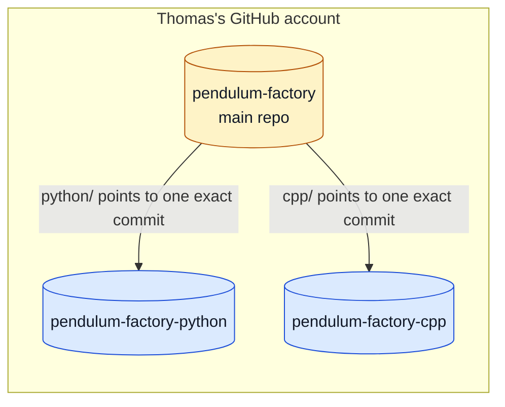
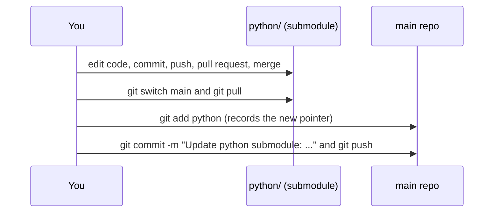

# MAS417 Repo Setup: one main repo with two submodules

> [!NOTE]
> **Shared copy.** Thomas keeps the original of this note in his Obsidian vault; this copy was synced on 2026-11-03 and converted for GitHub. Paths like `Project/...` and `repo-drafts/...` refer to the vault: the drafts are now the repos themselves. PlantUML blocks don't render on GitHub; the same diagrams are in `docs/uml/*.puml`.

We follow the spec's recommended layout (§7):
- one repo for the **Python** part;
- one for the **C++** part;
- a **main** repo that includes both as **git submodules**.

The drafts for all three are in `Project/repo-drafts/`. Copy them in when you create the repos.

## 1. How submodules work



- A submodule is **a full git repo inside another repo**. `python/` and `cpp/` have their own history, branches and pull requests.
- The main repo doesn't store their files. It stores **a pointer: the exact commit ID** of each submodule.
- One commit of the main repo therefore pins one exact version of everything. That's why the hand-in asks for one commit ID.
- When you change Python code, you commit **twice**:
  1. in `python/` (the actual change);
  2. in the main repo (moving the pointer to that new commit).



## 2. One-time setup (one person, ~20 min)

1. **Use Thomas's own GitHub account.** No organisation is needed: the spec only asks for a GitHub repo with the lecturer invited.
2. **Create three private, empty repos** on that account (no README, no `.gitignore`):
   - `pendulum-factory`
   - `pendulum-factory-python`
   - `pendulum-factory-cpp`
3. **Invite Øivind and the lecturer** to **all three** (Settings → Collaborators → Add people). Do it now so it isn't forgotten.
   - On a personal account every collaborator gets **write** access. There is no read-only role, so the lecturer can push too. That is harmless.
   - Only Thomas is an admin, so changing repo settings or inviting people is his job.
4. **Fill the two submodule repos from the drafts:**

```bash
# Python repo
git clone https://github.com/thomastte/pendulum-factory-python.git
cd pendulum-factory-python
# copy everything from repo-drafts/pendulum-factory-python/ into this folder (including .gitignore and pytest.ini)
git add .
git commit -m "Add project skeleton, README and gitignore"
git push
cd ..

# C++ repo
git clone https://github.com/thomastte/pendulum-factory-cpp.git
cd pendulum-factory-cpp
# copy everything from repo-drafts/pendulum-factory-cpp/
git add .
git commit -m "Add RK4 pendulum simulator with CMake build"
git push
cd ..
```

5. **Main repo:** copy its drafts in, then add the submodules. **Relative URLs** (`../`) make them work for anyone who has access to all three repos:

```bash
git clone https://github.com/thomastte/pendulum-factory.git
cd pendulum-factory
# copy everything from repo-drafts/pendulum-factory/ (README, .gitignore, docker-compose.yml, docs/, tools/, deliverables/)
git submodule add ../pendulum-factory-python.git python
git submodule add ../pendulum-factory-cpp.git cpp
git add .
git commit -m "Add main repo with Python and C++ submodules"
git push
```

`git submodule add` creates a `.gitmodules` file. Commit it; it is how others find the submodules.

## 2b. The setup we actually did (GitHub Desktop, Windows, 2 Nov)

Simpler than §2: no temporary clones. Repos live in `C:\Users\thoma\Documents\pendulum-factory`, outside the Obsidian vault.

**Before:** install **GitHub Desktop** and **Git for Windows** (default editor: VS Code; initial branch: override to `main`; everything else default). Restart GitHub Desktop after installing Git, or it won't find it.

1. **github.com:** create private repos `pendulum-factory-python`, `pendulum-factory-cpp` and `pendulum-factory` on `thomastte`. Template files from GitHub (README, `.gitignore`) are fine; the drafts overwrite them.
2. **Desktop:** clone `pendulum-factory` to `Documents\pendulum-factory`.
3. **Command Prompt** in that folder:
   ```
   git submodule add ../pendulum-factory-python.git python
   git submodule add ../pendulum-factory-cpp.git cpp
   ```
4. **Explorer:** copy the *contents* of each `repo-drafts\` folder into `python\`, `cpp\` and the main folder (Replace when asked). Replace `<owner>` in the main README with `thomastte` (no angle brackets).
5. **Desktop, submodules first:** File → Add local repository → `python`, check branch `main`, commit, push. Same for `cpp`. Say in the commit description which files are AI-drafted.
6. **Desktop, main repo:** commit (the list includes `.gitmodules`, `python` and `cpp`), push. On github.com, `python @ …` and `cpp @ …` link to the commits from step 5.
7. **Each repo → Settings → Collaborators:** invite Øivind and the lecturer. Personal repos have no read-only role, so both get write access.

**Øivind:** File → Clone → `pendulum-factory` (Desktop also clones the submodules), then Add local repository for `python` and `cpp`. If a submodule shows **detached HEAD**, pick `main` in the Current branch menu before working.

**Daily workflow in Desktop**
1. In `python` (or `cpp`): Current branch → **New branch** (`feat/params`), commit, then Publish branch → **Create Pull Request**. The other person merges it on GitHub.
2. Switch back to `main` → **Pull origin**.
3. In the main repo, Changes shows `python` as modified. Commit `Update python submodule: params.py`, then Push.
4. **After pulling the main repo:** if `python` or `cpp` shows as modified although you changed nothing, the submodule wasn't moved to the new pointer. Open the main repo in Command Prompt and run `git submodule update --init`, then switch the submodule back to `main`. (I'm not certain whether Desktop does this step on its own, so check.)

## 3. Each person: get everything

```bash
git clone --recurse-submodules https://github.com/thomastte/pendulum-factory.git
cd pendulum-factory
cd python && git switch main && cd ..      # see "detached HEAD" below
cd cpp && git switch main && cd ..
```

## 4. Daily workflow

**Work in a submodule as in any repo:**
```bash
cd python
git switch main && git pull
git switch -c feat/spoolman-client
# ... work, commit often ...
git push -u origin feat/spoolman-client
# open a pull request on GitHub for pendulum-factory-python; your partner reviews and merges
```

**After a merge, move the main repo's pointer.** Do this at least at every milestone, and always before hand-in:
```bash
cd python && git switch main && git pull && cd ..
git add python
git commit -m "Update python submodule: Spoolman client"
git push
```

**Get your partner's latest work:**
```bash
git pull                              # main repo
git submodule update --init           # put python/ and cpp/ at the commits the main repo points to
```

## 5. Pitfalls

| Symptom | Cause | Fix |
|---|---|---|
| `HEAD detached at abc123` inside `python/` | Normal after clone or `submodule update`: the submodule sits on the pinned commit, not on a branch | `git switch main` **before** you start working |
| Partner gets `fatal: reference is not a tree` | You pushed the main repo pointer but not the submodule commit it points to | Push the submodule first, then the main repo. To be safe: `git push --recurse-submodules=check` |
| Main repo still uses old code | You merged in the submodule but didn't update the pointer | `git add python` + commit in the main repo |
| `python/` folder is empty | Cloned without `--recurse-submodules` | `git submodule update --init` |
| GitHub's "Download ZIP" has empty `python/` and `cpp/` | GitHub zips never include submodules | Use `tools/make_handin.py` for the hand-in zip |

## 6. Hand-in

1. Everything merged and pushed in **both** submodules.
2. Main repo pointers updated, committed and pushed.
3. `python tools/make_handin.py`:
   - refuses if anything is uncommitted;
   - zips every tracked file from all three repos, including `deliverables/`;
   - writes `COMMIT.txt` with the main commit ID and both submodule commit IDs.
4. Unzip the result in a new folder and run it once (Mac test, plan §15).
5. In WISEflow give the **full 40-character commit ID of the main repo** (`git rev-parse HEAD`). It pins both submodules. Also list the two submodule IDs from `COMMIT.txt` in the report, since all three histories are evaluated.

## 7. What's in the drafts

| Repo | Files |
|---|---|
| `pendulum-factory` | `README.md` (full how-to-run, stock loading, team, licences), `.gitignore`, `docker-compose.yml` (Spoolman 0.27.0), `docs/uml/*.puml` (all six diagrams), `docs/ai-log.md`, `tools/make_handin.py`, `deliverables/.gitkeep` |
| `pendulum-factory-python` | `README.md`, `.gitignore`, `pytest.ini`, `requirements.txt` (pin it later), `pendulum/__init__.py`, `pendulum/simulate.py`, `tests/test_simulate.py`, `config/printer.json`, `config/stock_seed.json` (fill in), `examples/orders/example-order-01.json` |
| `pendulum-factory-cpp` | `README.md`, `.gitignore`, `CMakeLists.txt`, `src/main.cpp` |

**Tested here:**
- The three repos were built from these drafts, with the submodules linked.
- Cloning with `--recurse-submodules` pulls in both submodules.
- The C++ program builds, and `build/` stays out of git.
- `pytest` passes 4/4 with the simulator built, and 2 passed + 2 skipped without it.
- `make_handin.py` produces a zip containing all three repos.

> [!NOTE]
> **`.gitignore` files are hidden in Obsidian**
> Obsidian doesn't show files starting with a dot. They are in the draft folders. Open the folder in Finder/Explorer, or with VS Code, to see and copy them.
