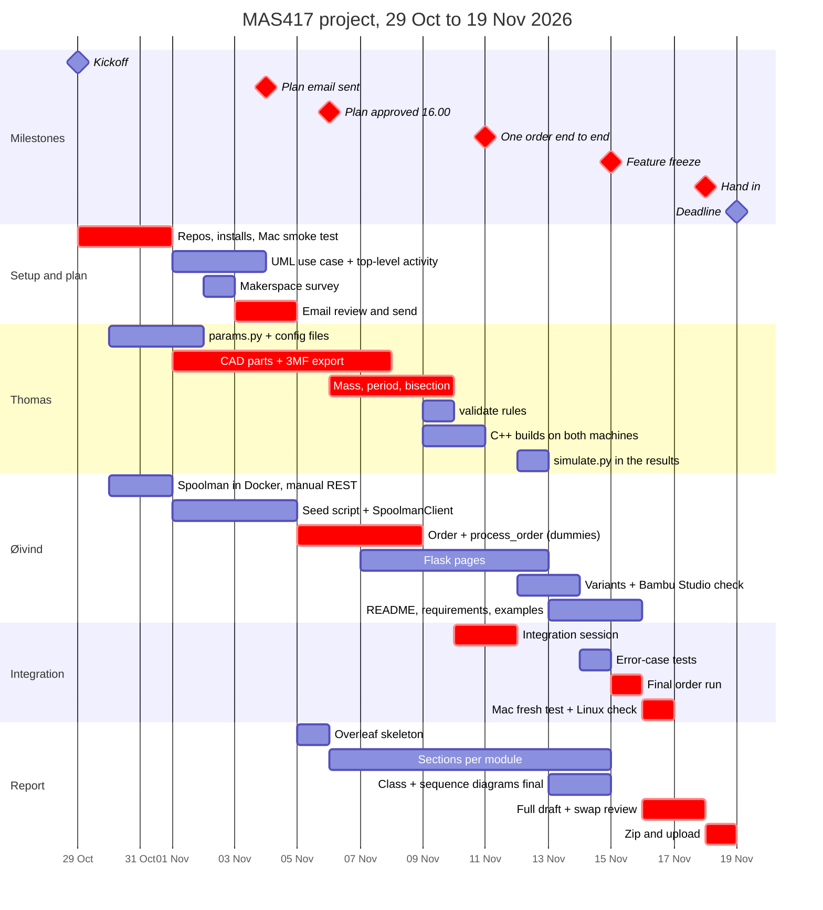
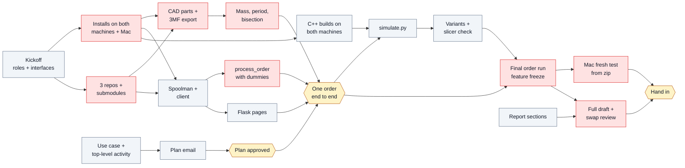
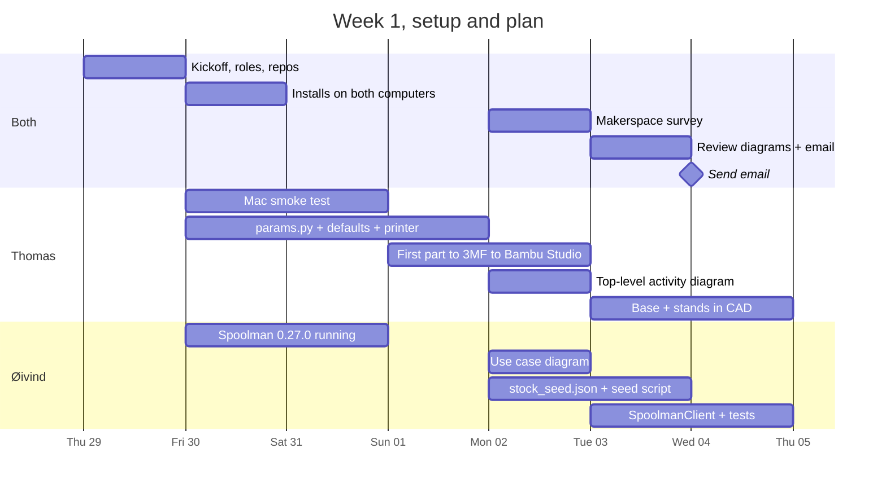
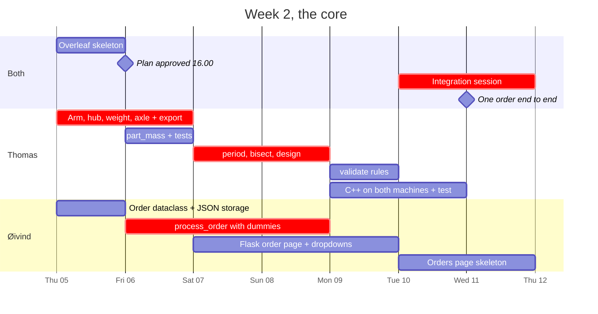
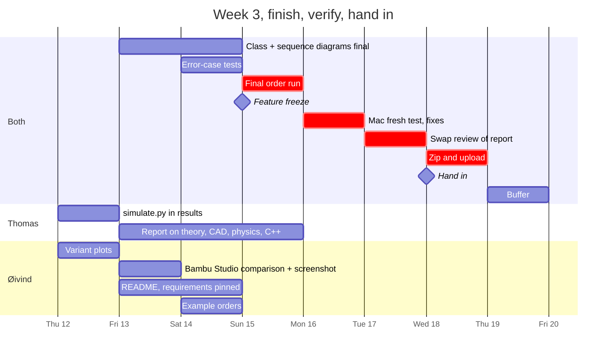
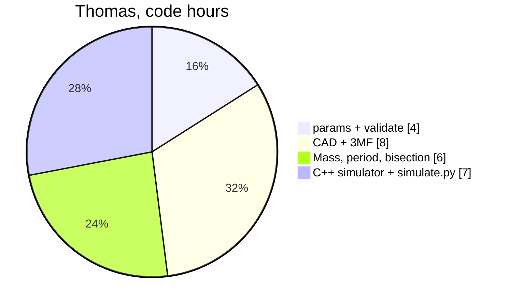
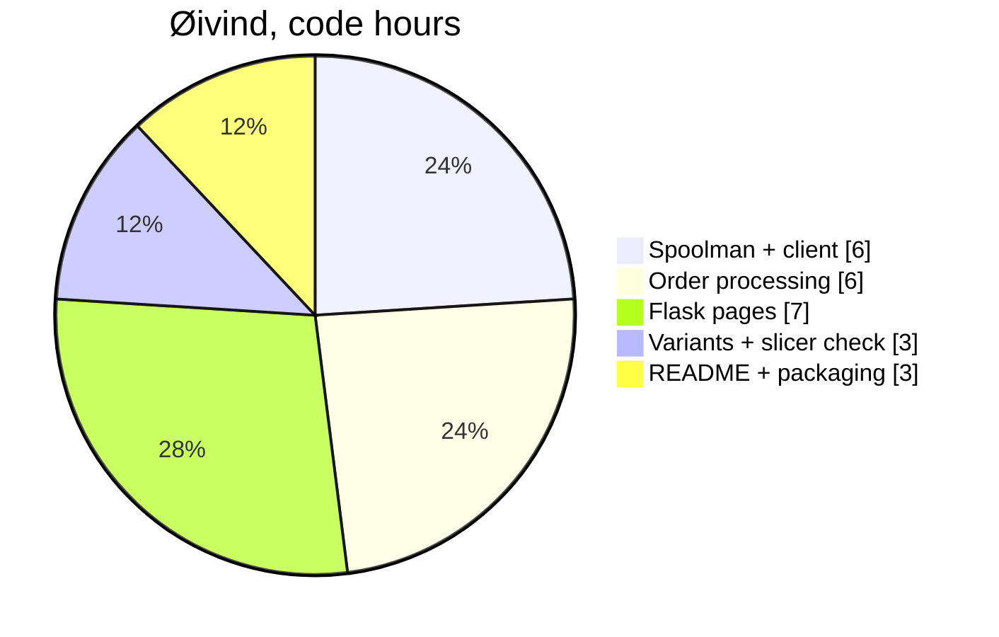

# MAS417 Roadmap: 29 Oct to 19 Nov

> [!NOTE]
> **Shared copy.** Thomas keeps the original of this note in his Obsidian vault; this copy was synced on 2026-11-03 and converted for GitHub. Paths like `Project/...` and `repo-drafts/...` refer to the vault: the drafts are now the repos themselves. PlantUML blocks don't render on GitHub; the same diagrams are in `docs/uml/*.puml`.

> [!IMPORTANT]
> **Fixed dates**
> - **Plan approved:** Fri 6 Nov, 16:00.
> - **Hand-in:** 19/20 Nov (confirm the time in WISEflow). We hand in **Wed 18 Nov**, which leaves a day of buffer.

> [!TIP]
> **Today, Thu 29 Oct: do these three things**
> 1. **Kickoff (1 h together):**
>    - roles decided: **Thomas** = product & physics, **Øivind** = factory & stock ✅
>    - read §8 of the plan, the functions you agree on.
> 2. **Create the three repos on Thomas's GitHub account** from [Repo Setup](repo-setup.md). Invite Øivind and the lecturer.
> 3. **Start installing** Python 3.12, Docker Desktop, CMake + compiler, Bambu Studio and the Obsidian PlantUML plugin.

**What's in this note:**
1. The whole project at a glance
2. Critical path
3. Milestones
4. Week 1, setup and plan
5. Week 2, the core
6. Week 3, finish, verify, hand in
7. Workload
8. Working rhythm
9. If you fall behind
10. Tracking progress

---

## 1. The whole project at a glance

> [!NOTE]
> **If a chart shows an error in Obsidian**
> The week charts use `tickInterval 1day`, which needs Mermaid 10.3 or newer. If a week chart fails to render, delete that line from it.

Red bars are the **critical path**: if one of them slips, the hand-in slips. The red vertical line is today.

---

## 2. Critical path: what blocks what

Each arrow means "must be done before". Red boxes are on the critical path.

The longest chain is the installs, then CAD, then physics, then end-to-end, then the final run, the Mac test and hand-in. **CAD is the riskiest item:** it's new for both of you and it feeds everything after it, so Thomas starts it on day 3.

---

## 3. Milestones

| # | Date | Milestone | Done means | Who checks |
|---|---|---|---|---|
| M0 | Thu 29 Oct | Kickoff | Roles decided, the §8 functions agreed, repos created, lecturer invited | both |
| M1 | Wed 4 Nov | Plan email sent | [Plan email (draft)](plan-email-draft.md) sent with group number and both diagrams | both |
| M2 | Fri 6 Nov | Plan approved | Reply received. If rejected, resubmit the same day | both |
| M3 | Wed 11 Nov | One order end to end | Order typed in the browser → 3MF files in `output/` → Spoolman spool weight goes down. Ugly is fine | both |
| M4 | Sun 15 Nov | Feature freeze | All §3.1 requirements work; example orders processed into `deliverables/`; after this, bug fixes only | both |
| M5 | Wed 18 Nov | Handed in | Report, zip and full commit ID uploaded in WISEflow | both |

---

## 4. Week 1: Thu 29 Oct to Wed 4 Nov (setup and plan)

| Day | Thomas | Øivind | Together |
|---|---|---|---|
| Thu 29 | | | Kickoff 1 h, repos, start installs |
| Fri 30 | `params.py` dataclass | Docker Desktop, Spoolman up, try GET/POST in the browser or curl | Finish installs. Thomas: Mac smoke test |
| Sat 31 | `defaults.json`, `printer.json` | Read Spoolman API docs, write down the real field names | |
| Sun 1 | First CadQuery part → 3MF → open in Bambu Studio | Start `SpoolmanClient` | |
| Mon 2 | Top-level activity diagram | Use case diagram, `stock_seed.json` | **Makerspace survey** (30–60 min) |
| Tue 3 | CAD: base + stands | Seed script, test it against Spoolman | **Review diagrams + email (30 min)** |
| Wed 4 | CAD: continue | `SpoolmanClient` timeout tests | **Send the email (morning)** |

- [ ] [Both] Kickoff: roles A/B decided, plan §8 functions agreed 📅 2026-10-29
- [ ] [Both] 3 repos on Thomas's GitHub + submodules, Øivind and lecturer invited ([Repo Setup](repo-setup.md)) 📅 2026-10-29
- [ ] [Both] Installed on both computers: Python 3.12, Docker Desktop, CMake + compiler, Bambu Studio, Obsidian PlantUML 📅 2026-10-30
- [ ] [Thomas] Mac smoke test: CadQuery imports, Spoolman starts, C++ builds (plan §15.1 step 1) 📅 2026-10-31
- [ ] [Thomas] `params.py`, `defaults.json`, `printer.json` 📅 2026-11-01
- [ ] [Øivind] Spoolman 0.27.0 running in Docker; real API field names written down 📅 2026-10-31
- [ ] [Thomas] First part exported to 3MF and checked in Bambu Studio (size, lying flat) 📅 2026-11-02
- [ ] [Both] Makerspace survey: printers, AMS?, every filament with type, colour, brand and net weight, photos of labels 📅 2026-11-02
- [ ] [Thomas] Top-level activity diagram final ([Plan email (draft)](plan-email-draft.md)) 📅 2026-11-02
- [ ] [Øivind] Use case diagram final 📅 2026-11-02
- [ ] [Øivind] `stock_seed.json` filled (with datasheet densities) and seed script works 📅 2026-11-03
- [ ] [Both] Email reviewed, group number filled in 📅 2026-11-03
- [ ] [Both] **Plan email sent** 📅 2026-11-04
- [ ] [Øivind] `SpoolmanClient` with timeout handling + tests 📅 2026-11-04

---

## 5. Week 2: Thu 5 Nov to Wed 11 Nov (the core)

| Day | Thomas | Øivind | Together |
|---|---|---|---|
| Thu 5 | CAD: arm with hub, weight, axle; `export_3mf` for all parts | `Order` dataclass, save/load JSON | Overleaf skeleton (UiA template, section headings from plan §13) |
| Fri 6 | `part_mass` + test (cube) | `process_order` skeleton, with dummies for A's functions | **Approval by 16:00.** If rejected, fix and resend today |
| Sat 7 | `period` + tests (point mass, small angle) | Flask order page | |
| Sun 8 | `bisect` + `design()` with reject reason | Filament dropdowns from Spoolman | |
| Mon 9 | `validate()` rules; C++ builds on both machines | Error handling in `process_order` (offline, insufficient) | |
| Tue 10 | C++ test vs exact formula | Orders page skeleton | **Integration session (2 h):** swap dummies for real functions |
| Wed 11 | Fix integration bugs | Fix integration bugs | **M3: one order end to end.** Update submodule pointers in the main repo |

- [ ] [Both] Overleaf skeleton with section headings 📅 2026-11-05
- [ ] [Thomas] All six parts in `cad.py` + `export_3mf` (one file per part) 📅 2026-11-06
- [ ] [Øivind] `Order` dataclass + JSON storage 📅 2026-11-05
- [ ] [Both] **Plan approved** (resubmit the same day if rejected) 📅 2026-11-06
- [ ] [Thomas] `part_mass` with tests 📅 2026-11-06
- [ ] [Øivind] `process_order` following plan §4, using dummies 📅 2026-11-08
- [ ] [Thomas] `period`, `bisect`, `design()` with tests 📅 2026-11-08
- [ ] [Øivind] Flask order page with live filament dropdowns 📅 2026-11-09
- [ ] [Thomas] `validate()` with one test per rule 📅 2026-11-09
- [ ] [Thomas] C++ simulator builds on both computers; `test_simulate.py` passes 📅 2026-11-10
- [ ] [Øivind] Postpone on Spoolman offline / insufficient filament 📅 2026-11-10
- [ ] [Both] Integration session: dummies replaced 📅 2026-11-10
- [ ] [Both] **M3: one real order end to end**, submodule pointers updated in the main repo 📅 2026-11-11

---

## 6. Week 3: Thu 12 Nov to Wed 18 Nov (finish, verify, hand in)

| Day | Thomas | Øivind | Together |
|---|---|---|---|
| Thu 12 | `simulate.py` wired into results (T_sim shown) | `variants.py`: PLA vs PETG weight, 5° vs 45° | |
| Fri 13 | Report: theory + CAD + physics | Bambu Studio grams vs ours + **sliced screenshot** | Class diagram final |
| Sat 14 | Report: bisection (pseudocode + diagram) + C++ | Example orders (normal, impossible, insufficient, offline) | **Error-case tests:** stop Docker, empty spool, delete `cpp/build`. Sequence diagram final |
| Sun 15 | | `requirements.txt` pinned with `==` | **Final order run → `deliverables/`. Feature freeze** |
| Mon 16 | Report polish | Report polish | **Thomas: Mac test from the zip** (plan §15) + Linux container check, fix |
| Tue 17 | Review B's sections | Review A's sections | Numbers vs `result.json`, Use of AI, references, abstract |
| Wed 18 | | | **Final commits → update pointers → `make_handin.py` → unzip-and-run → upload** |
| Thu 19 | | | Buffer |

- [ ] [Thomas] `simulate.py` in the results; simulated period shown 📅 2026-11-12
- [ ] [Øivind] `variants.py`: two variant plots + table 📅 2026-11-12
- [ ] [Øivind] Bambu Studio grams comparison + **sliced screenshot** 📅 2026-11-13
- [ ] [Both] Class diagram final 📅 2026-11-13
- [ ] [Øivind] README complete; `requirements.txt` pinned with `==` 📅 2026-11-14
- [ ] [Øivind] Example orders: 3–4 normal, 1 impossible, 1 insufficient, 1 Spoolman stopped 📅 2026-11-14
- [ ] [Both] Error-case tests passed; sequence diagram final 📅 2026-11-14
- [ ] [Both] **Final order run → `deliverables/`, feature freeze** 📅 2026-11-15
- [ ] [Thomas] **Mac fresh test from the zip** + Linux container check; fixes merged 📅 2026-11-16
- [ ] [Both] Full report draft; each reviews the other's sections 📅 2026-11-17
- [ ] [Both] Use of AI section + `docs/ai-log.md` complete 📅 2026-11-17
- [ ] [Both] **Hand in:** report + zip + full commit ID in WISEflow 📅 2026-11-18

---

## 7. Workload

| | Code | UML | Report | Shared | Total |
|---|---|---|---|---|---|
| Thomas | 25 h | 3 h | 12 h | 7 h | **~47 h** |
| Øivind | 25 h | 3 h | 12 h | 7 h | **~47 h** |

That's about **16 h per person per week**.

---

## 8. Working rhythm

**Daily, 5 minutes (message or call):** what I did, what I'll do, what blocks me.

**Integration sessions** (Tue 10 Nov and Sat 14 Nov, 2 h, together in person if possible): merge, run one order, fix together.

**Weekly sync** (Mondays 2, 9 and 16 Nov, 30 min):
1. Compare the Gantt with reality. Which red bars are late?
2. Any change to the agreed functions (plan §8)? Change them only if both agree.
3. Report: which sections are drafted?
4. Update the submodule pointers in the main repo.

**Definition of done**, for a task to be ticked off:
- [ ] Code merged via a pull request that the other person reviewed
- [ ] At least one test, or a written manual check in the pull request
- [ ] AI-assisted parts marked in the code and logged in `docs/ai-log.md`
- [ ] Two or three lines for the report written in Overleaf or `docs/`

**Commit rule:** small commits with clear messages, both people every week. The git history of all three repos is graded.

---

## 9. If you fall behind

Check at **M3 (Wed 11 Nov)**. If the end-to-end run doesn't work, cut from the top of this list:

| Order | Cut | Cost |
|---|---|---|
| 1 | Everything in plan §1 "If time" | none, it was optional |
| 2 | Orders page styling: a plain HTML table | looks |
| 3 | Variants: keep only 5° vs 45° (no new design needed) + one infill variant | a smaller comparison, still meets "≥2 variants" |
| 4 | `stock_seed.json` with fewer filaments (only what the example orders use) | less stock |
| 5 | C++ simulator stays, but the SciPy fallback becomes the main path if C++ won't build on one machine | weaker language-mix argument |

**Never cut:**
- anything in spec §3.1;
- the four UML diagrams;
- the Use of AI section;
- the Mac fresh test;
- the pinned `requirements.txt`.

**Buffer:** Thu 19 Nov is completely free. Use it, and don't plan anything into it.

---

## 10. Tracking progress

- **Gantt:** when a task is finished, add `done,` in its line, e.g. `:done, crit, a2, 2026-11-01, 7d`. It turns grey.
- **Checkboxes:** the tasks above have 📅 due dates, so they show up on your Obsidian homepage task list.
- **GitHub:**
  - make one GitHub Project board on Thomas's account, linked to all three repos and shared with Øivind, with columns Backlog / In progress / Review / Done;
  - one issue per task;
  - link pull requests with `Closes #12`;
  - take a screenshot of the board for the report's "Project organisation" section.
