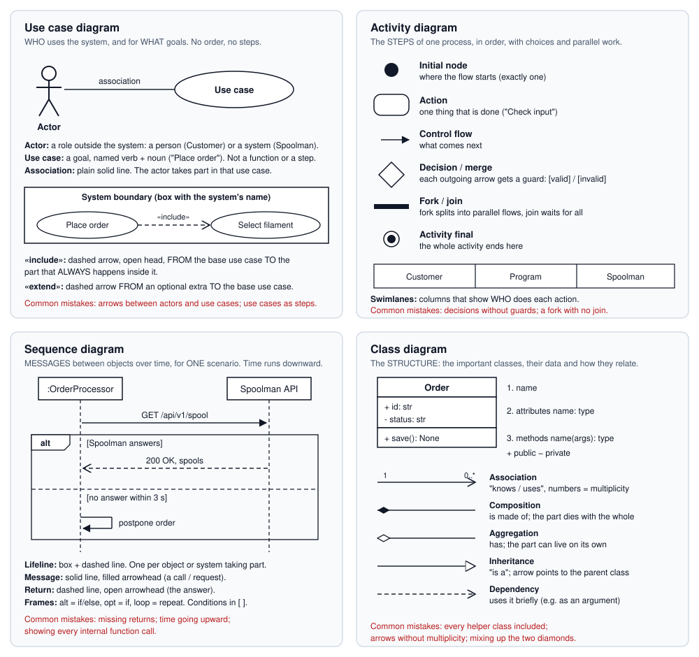
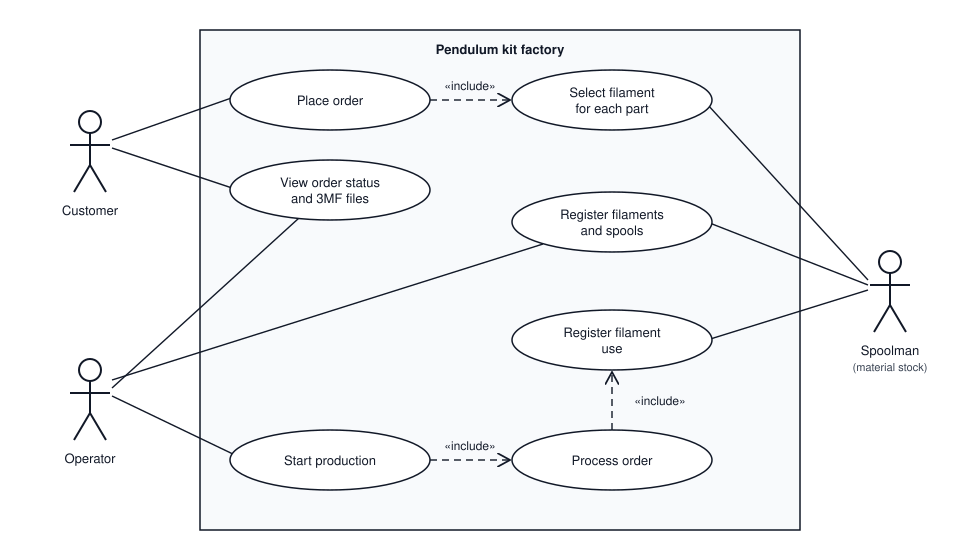

# MAS417 Project: What You Need to Know

> [!NOTE]
> **Shared copy.** Thomas keeps the original of this note in his Obsidian vault; this copy was synced on 2026-11-03 and converted for GitHub. Paths like `Project/...` and `repo-drafts/...` refer to the vault: the drafts are now the repos themselves. PlantUML blocks don't render on GitHub; the same diagrams are in `docs/uml/*.puml`.

This lists only what the project needs. Each topic has:
- **Understand:** what you must be able to explain, for the report and for using it.
- **Skip:** what you don't need.
- **Learn from:** an official source to read.
- **Check yourself:** questions to answer without notes.

Times are rough first-pass estimates.

| # | Topic | Who needs it | Time |
|---|---|---|---|
| 1 | UML | both | 2–3 h |
| 2 | Python for this project | both | 3–4 h |
| 3 | C++ and CMake for the simulator | Thomas (Øivind: read only) | 2–3 h |
| 4 | How Python runs the C++ program | both | 30 min |
| 5 | Git, GitHub and submodules | both | 2 h |
| 6 | Docker | Øivind (Thomas: just run it) | 1 h |
| 7 | REST APIs and Spoolman | Øivind (Thomas: basics) | 1–2 h |
| 8 | Flask | Øivind | 2 h |
| 9 | CadQuery and 3MF | Thomas | 2–3 h |
| 10 | 3D printing on Bambu Lab printers | both | 1 h |
| 11 | Pendulum physics | Thomas (Øivind: basics) | 1–2 h |
| 12 | Numerical methods: bisection, RK4, zero crossings | Thomas (Øivind: basics) | 1–2 h |
| 13 | Report rules: IEEE, Use of AI, hand-in | both | 30 min |

---

## 1. UML

**What it is.** UML (Unified Modeling Language) is a *standard drawing language* for software. Every shape and arrow has a fixed meaning, the way symbols do in an electrical schematic. That is why the spec says "follow the UML standard": a box or arrow drawn the wrong way means something different.

**The project needs four diagrams.** Each one answers one question:

| Diagram | Question it answers | Our version |
|---|---|---|
| Use case | *Who* uses the system, and *for what*? | Customer, Operator, Spoolman and their goals |
| Activity | *What steps* happen, in what order, with which choices? | One order, from placed to 3MF files + filament registered |
| Sequence | *Which messages* go back and forth, in time order? | Our program ↔ Spoolman REST calls for one order |
| Class | *What is the code made of*, and how are the parts related? | Order, PendulumParams, SpoolmanClient, OrderProcessor, the C++ PendulumSim |

**The symbols** (read this sheet once, then keep it open while drawing):

### Use case diagram, explained with ours

- **Actors** are outside the box. Spoolman is an actor because it is *another system* our program talks to.
- **Each ellipse is a goal**, not a function.
- **«include»** arrows go *from* the bigger use case *to* the part it always contains. "Place order" always includes "Select filament".
- **Lines between actors and use cases have no arrowheads.**

### Activity diagram (see [Plan, 4. One order, start to finish (UML activity diagram)](plan.md#4-one-order-start-to-finish-uml-activity-diagram))

- Read it top to bottom like a flowchart, with stricter rules:
  - exactly one filled start dot;
  - every diamond's outgoing arrows labelled with a guard in `[ ]`;
  - parallel work between a fork bar and a join bar;
  - a bullseye wherever the activity ends.
- The **swimlanes** (Customer / Program / Spoolman) show *who* does each step.
- Ours has a fork because building the 3MF files and running the simulation don't depend on each other.

### Sequence diagram (see [Plan, 5.3 REST calls for one order (UML sequence diagram)](plan.md#53-rest-calls-for-one-order-uml-sequence-diagram))

- **Time runs downward.** Each participant has a dashed lifeline.
- A **solid arrow** is a request (`GET /api/v1/spool`). A **dashed arrow** is the reply (`200 OK`).
- **`alt` boxes** are if/else, **`loop`** repeats, and the condition is written in `[ ]`.
- Show only the REST calls and their answers, not every internal Python function.

### Class diagram (see [Plan, Class diagram](plan.md#class-diagram))

- A box has three parts: name, attributes (`name: type`), methods (`name(args): return type`). `+` means public, `-` means private.
- Show only the *important* classes. A Python file full of plain functions is not a class, so leave it out.
- Arrows:
  - plain arrow = "uses / knows about", with numbers = how many (multiplicity);
  - filled diamond = "is made of";
  - dashed arrow = "uses briefly".

### How we draw them: PlantUML

- **PlantUML** turns text into standard UML pictures. Because it's text, the diagrams live in git next to the code, and you can change them in seconds.
- **In Obsidian:** install the community plugin **"PlantUML"**. Any code block marked `plantuml` then renders.
- **In VS Code:** install the extension **"PlantUML"** for live preview (it needs Java, or set it to use the PlantUML server).
- **Alternative without code:** draw.io (diagrams.net) has UML shape libraries if you prefer dragging boxes.

**Learn from:** the PlantUML guides for [use case](https://plantuml.com/use-case-diagram), [activity](https://plantuml.com/activity-diagram-beta), [sequence](https://plantuml.com/sequence-diagram) and [class](https://plantuml.com/class-diagram) diagrams.

**Check yourself:**
- Why is Spoolman an actor and not a use case?
- What does a dashed arrow mean in a sequence diagram? In a use case diagram?
- What must every arrow leaving a decision diamond have?
- What's the difference between the filled and the hollow diamond?

---

## 2. Python for this project

**Understand:**
- **Virtual environment + `requirements.txt`:** `python -m venv .venv`, activate it, `pip install -r requirements.txt`. This is how the examiner installs your project.
- **Modules and imports:** one file = one module (`pendulum/physics.py`). `from pendulum.physics import period`.
- **Functions, classes and dataclasses:** `@dataclass` makes a class that is mostly data (`PendulumParams`, `Order`) without boilerplate.
- **dict and list,** and reading/writing **JSON** (`json.load`, `json.dump`). Every order and design is a JSON file.
- **Exceptions:** `try/except`, `raise`, and your own `class StockUnavailable(Exception)`. This is how "Spoolman doesn't answer" becomes "order postponed" instead of a crash.
- **`pathlib.Path`** for file paths that work on Windows and macOS alike.
- **f-strings** for messages.
- **`if __name__ == "__main__":`**, the entry point of a script.
- **pytest:** a file `tests/test_x.py` with functions `test_...()` that `assert` something. Run with `pytest`.

**Skip:** async, decorators (except Flask's `@app.route`), type-checking tools, metaclasses.

**Learn from:**
- [Python tutorial, chapters 4–9](https://docs.python.org/3/tutorial/)
- [dataclasses](https://docs.python.org/3/library/dataclasses.html)
- [pytest getting started](https://docs.pytest.org/en/stable/getting-started.html)

**Check yourself:**
- What happens if an exception is raised inside `process_order` and nothing catches it?
- Why does the project need `requirements.txt`?

---

## 3. C++ and CMake (for the simulator)

**Understand:**
- **Compiling:** source `main.cpp` → compiler → an executable program. Python runs line by line; C++ must be built first, on each operating system.
- **CMake:** `CMakeLists.txt` describes *what* to build. Then:
  - `cmake -S cpp -B cpp/build` (configure)
  - `cmake --build cpp/build --config Release` (build)

  The same commands work on Windows, macOS and Linux. This is the "organized using CMake" the spec asks for (§7).
- **`main(int argc, char* argv[])`:** how a program receives command-line arguments. `std::stod` turns text into a `double`.
- **`struct` vs `class`:** a struct is plain data (`State {theta, omega}`); a class bundles data and methods (`PendulumSim`). `private` members end with `_` by convention.
- **`const` and references (`const State& s`):** pass something without copying it and promise not to change it.
- **`std::vector`, `<cmath>`, `std::ofstream`:** a growing list, math functions, and writing a file.
- **Return codes:** `return 0` means success, anything else means error. Python checks this.

**Skip:** pointers and `new`/`delete`, templates, inheritance, pybind11, Eigen.

**Learn from:** the [CMake tutorial, step 1 only](https://cmake.org/cmake/help/latest/guide/tutorial/A%20Basic%20Starting%20Point.html) and [learncpp.com chapters 1–2](https://www.learncpp.com/).

**Check yourself:**
- Why must the examiner build the C++ part but not the Python part?
- What does `rk4Step` return, and why is it `const`?

---

## 4. How Python runs the C++ program

- Python starts the C++ program like typing a command in a terminal: `subprocess.run([exe, "0.002", "0.05", ...], capture_output=True, text=True, check=True)`.
- **In:** numbers as text arguments. **Out:** a CSV file (the motion) and one line on the screen, `period=0.6491...`, which Python reads.
- `check=True` means a non-zero return code raises an error in Python.
- If the program isn't built, Python uses the SciPy version instead. The project still runs; it just doesn't use C++.
- **How Python finds the program:**
  - The two parts are separate repos, but in the main repo they sit side by side as `python/` and `cpp/`.
  - So Python looks in `../cpp/build/` relative to its own folder, checking all three names the build can produce.
  - The environment variable `PENDULUM_SIM` can point elsewhere.
- **Why this way:** it's the simplest possible connection. Nothing needs to be shared between the languages except numbers and a file.

**Check yourself:**
- What happens on Windows if you look for `pendulum_sim` but the file is called `pendulum_sim.exe`? (See `find_simulator()` in the plan, §3.4.)
- Why does the Python repo still work on its own, without the C++ repo next to it?

---

## 5. Git, GitHub and submodules

**Understand:**
- `clone`, `status`, `add`, `commit -m "..."`, `push`, `pull`
- **Branches:** `git switch -c feat/cad-parts`. Do your work there, push, then open a **pull request** on GitHub. The other person reads it and merges it.
- **Merge conflicts:** when you both changed the same lines. Git marks them with `<<<<<<<`. Keep the right version, then commit.
- **`.gitignore`:** files git never tracks (`.venv/`, `build/`, `spoolman-data/`). Each of our three repos has its own (drafts in `repo-drafts/`).
- **Commit messages are graded:** short, imperative, saying what and why ("Add press-fit hole to stand side").
- **Full commit ID:** `git rev-parse HEAD` gives the 40-character ID you hand in.

### Submodules (we use them, spec §7)

- **The setup:** three repos.
  - `pendulum-factory` is the **main** repo.
  - It contains `pendulum-factory-python` as the folder `python/` and `pendulum-factory-cpp` as `cpp/`.
- **A submodule is a full repo inside another repo.** The main repo only stores **which commit** of each submodule to use: a pointer.
- **Why bother:**
  - one commit ID of the main repo pins the exact version of everything, which is what the hand-in asks for;
  - the Python and C++ histories stay clean and separate.
- **The one habit to learn:** change code in `python/`, commit and push there, **then** commit in the main repo to move the pointer (`git add python` + commit).
- **The two classic surprises:**
  - after cloning, the submodules are in **"detached HEAD"** (pinned to a commit, not on a branch). Run `git switch main` inside them before working;
  - GitHub's "Download ZIP" leaves `python/` and `cpp/` empty. Use `tools/make_handin.py`.
- **GitHub Desktop** handles everyday commits, branches and pull requests. Adding a submodule and `git submodule update --init` need the command line (Repository → Open in Command Prompt).
- Step-by-step commands: [Repo Setup](repo-setup.md).

**Skip:** rebase, cherry-pick, `git submodule foreach` tricks, tags beyond basics.

**Learn from:**
- [Pro Git, chapters 2 and 3.1–3.2](https://git-scm.com/book/en/v2), or VS Code's built-in git panel;
- for submodules, [Pro Git 7.11 Submodules](https://git-scm.com/book/en/v2/Git-Tools-Submodules), the first half.

**Check yourself:**
- Why should you pull before starting work each day?
- You merged a fix in `pendulum-factory-python`, but your partner's main repo still runs the old code. Why, and what's the fix?
- Which commit ID goes into WISEflow, and why is that one enough?

---

## 6. Docker (for Spoolman)

**Understand:**
- An **image** is a packaged program (Spoolman). A **container** is that image running.
- **`docker compose up -d`** starts what `docker-compose.yml` describes. **`docker compose down`** stops it.
- **Ports `"7912:8000"`:** port 7912 on your computer leads to port 8000 inside the container. That's why the API is at `localhost:7912`.
- **Volume:** a folder on your disk where Spoolman keeps its database, so the data survives restarts.
- **Pinned tag** (`spoolman:0.x.y`, not `latest`): the examiner gets the same version you tested.
- Install **Docker Desktop** on Windows and macOS.

**Skip:** writing a Dockerfile, networks, Kubernetes.

**Learn from:** [Docker Compose quickstart](https://docs.docker.com/compose/gettingstarted/) and the [Spoolman wiki](https://github.com/Donkie/Spoolman/wiki).

**Check yourself:** what happens to your registered filaments if you delete the `spoolman-data` folder?

---

## 7. REST APIs and Spoolman

**Understand:**
- **REST** is a program offering its data at URLs. You talk to it with HTTP **methods**:

  | Method | Meaning | Our use |
  |---|---|---|
  | GET | read | list filaments and spools |
  | POST | create new | register a filament or spool |
  | PUT | change existing | subtract used filament from a spool |

- **Data is sent and received as JSON** (the same format as our order files).
- **Status codes:** `200` OK, `201` created, `404` not found, `422` your data was wrong, `500` server error. **No reply at all** (Spoolman stopped) is a different case: a `ConnectionError` or `Timeout` in Python.
- **`requests`:** `requests.get(url, timeout=3).json()`. Always set a timeout, or a dead server hangs your program.
- **Try it by hand first:** open `http://localhost:7912/api/v1/filament` in a browser. Spoolman also serves interactive API docs where you can send test requests.

**Skip:** authentication, OpenAPI code generators.

**Learn from:** [Requests quickstart](https://requests.readthedocs.io/en/latest/user/quickstart/) and the Spoolman API docs (served by your running Spoolman).

**Check yourself:** why is "Spoolman doesn't answer" a postpone and not a reject?

---

## 8. Flask (the GUI)

**Understand:**
- `app = Flask(__name__)`, and `@app.route("/orders", methods=["GET", "POST"])` connects a URL to a function.
- `render_template("order.html", filaments=...)` fills an HTML template. In Jinja templates, `{{ value }}` prints a value and `` loops.
- `request.form["period"]` reads a submitted form. `redirect(url_for("orders"))` sends the user to another page.
- Run with `flask --app pendulum.app run --port 5050`, then open `http://localhost:5050`. On macOS the default port 5000 is taken by AirPlay Receiver.

**Skip:** databases, logins, blueprints, JavaScript frameworks.

**Learn from:** the [Flask quickstart](https://flask.palletsprojects.com/en/stable/quickstart/), up to "Rendering Templates" and "The Request Object".

**Check yourself:** what does the browser send when the customer clicks "Order"?

---

## 9. CadQuery and 3MF

**Understand:**
- **Everything starts with `cq.Workplane("XY")`.** Then `.box(w, d, h)`, `.cylinder(h, r)`, `.faces(">Z").workplane().hole(d)`, `.cut(other)`, `.union(other)`, `.translate((x, y, z))`.
- **Units are millimetres.**
- `part.val().Volume()` and `part.val().Area()` feed the mass model. `part.val().BoundingBox()` gives the size used for the build-volume check.
- **Export with `cq.exporters.export(part, "arm.3mf")`.** Check the result in Bambu Studio: right size, lying flat on the plate.
- **3MF vs STL:** both hold the mesh, but 3MF also stores units and metadata (it's a zip file inside). The spec doesn't accept STL as the final product.
- **Print orientation:** model each part the way it lies on the plate (flat side down).
- **Viewing while you work:** the VS Code extension "OCP CAD Viewer" shows CadQuery parts live.

**Skip:** assemblies, constraints, STEP files, fillets (unless you have time).

**Learn from:** the [CadQuery quickstart](https://cadquery.readthedocs.io/en/latest/quickstart.html), which builds exactly our kind of part: a block with a bearing hole.

**Check yourself:** why do we model the hub and the rod separately, then union them?

---

## 10. 3D printing on Bambu Lab printers

**Understand:**
- **Printers:** P2S (or A1). Both have a **256 × 256 × 256 mm** build volume and a 0.4 mm nozzle.
- **Slicer:** **Bambu Studio** turns the 3MF into printer instructions. After slicing it shows the **filament used in grams**. That's what you compare with our mass estimate, and what you screenshot for the report (§3).
- **Walls** ("wall loops"): solid outer lines, usually 2, each about 0.42 mm wide.
- **Infill:** the inside pattern, e.g. 15–20 %. Only that fraction is plastic.
- **Top/bottom shells:** solid layers at the top and bottom of the part.
- **Filament types:** PLA (about 1.24–1.26 g/cm³) and PETG (about 1.27 g/cm³). **Look up the exact density in the datasheet for the brand in the makerspace.**
- **Spool net weight:** usually 1000 g of plastic, not counting the spool itself.
- **AMS** (automatic material system): lets the P2S print several filaments in one job. We don't rely on it.
- **Never change the filament type on the makerspace printers.**

**Learn from:** the [Bambu Lab wiki](https://wiki.bambulab.com/en/home) (Bambu Studio basics, P2S/A1 pages).

**Check yourself:** if you double the infill, does the mass double? (No. Why not?)

---

## 11. Pendulum physics

**Understand:**
- **A physical pendulum** is a rigid body swinging around an axle (not a point mass on a string).
- **Centre of mass distance `d`:** mass-weighted average distance from the axle.
- **Moment of inertia `I` about the axle:** how hard it is to start rotating.
  - Rod from the axle: m·L²/3.
  - Disc at distance L_w: ½·m·R² + m·L_w². The second part is the **parallel-axis theorem**.
- **Small swings:** T = 2π·√(I / (M·g·d)).
- **Bigger swings take longer.** The exact period uses an elliptic integral. At 5° the difference is about 0.05 %; at 45° it's about 4 %. This is why the order states an amplitude.
- **Moving the weight down makes the period longer,** except very close to the axle. That's why bisection can find the right position.

**Learn from:** [OpenStax University Physics Vol. 1, §15.4 Pendulums](https://openstax.org/books/university-physics-volume-1/pages/15-4-pendulums) (cited in the spec).

**Check yourself:**
- Why doesn't the axle's mass appear in the formula?
- If every part were printed in a filament twice as dense, why would the period stay exactly the same?

---

## 12. Numerical methods

**Bisection** (finds the weight position):
- Start with an interval [lo, hi] where the error changes sign.
- Halve it, keep the half where the sign still changes, and repeat until it's narrower than the tolerance.
- It always works if the sign changes, and every step halves the uncertainty.
- 15 steps shrink 200 mm to 0.006 mm.

**RK4, Runge–Kutta 4th order** (the C++ simulator):
- To step from t to t + dt, it evaluates the slope four times (at the start, twice in the middle, at the end) and takes a weighted average.
- It is much more accurate than Euler's method for the same step size.
- With dt = 0.1 ms the error is far below anything we can measure.

**Zero crossings** (getting the period from the motion):
- Find each time θ goes from negative to positive.
- Interpolate linearly between the two samples to get the exact crossing time.
- The period is the average time between crossings.

**Honest limitation:**
- The simulator solves the same equation the formula comes from, so agreement proves the *code* is right, not that the *real* pendulum behaves like that.
- Real checks are the Bambu Studio grams and, if time allows, a printed kit.

**Check yourself:**
- What happens to bisection if the period isn't reachable?
- Why interpolate the zero crossings instead of taking the nearest sample?

---

## 13. Report rules

- **IEEE citations:** numbered [1], [2] in order of first use. Cite docs, datasheets and OpenStax. AI is **not** a source.
- **"Use of AI" section (mandatory):** which tools, for what, and how you checked the output. Mark AI-assisted code with a comment.
- **Plagiarism check:** be clear what is your code and what is borrowed, and check licences.
- **Hand-in:**
  - report (repo link as a footnote)
  - zip (runnable code + orders + 3MF files)
  - full commit ID
